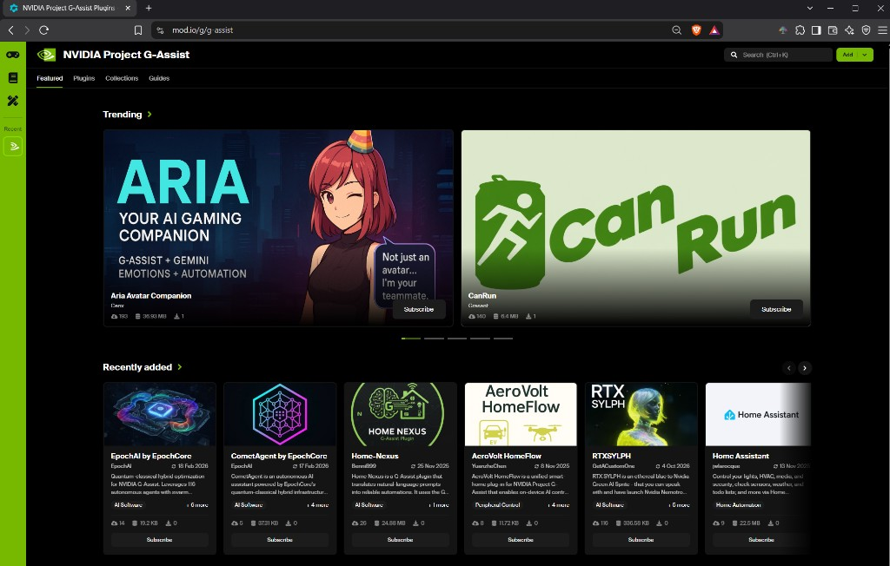
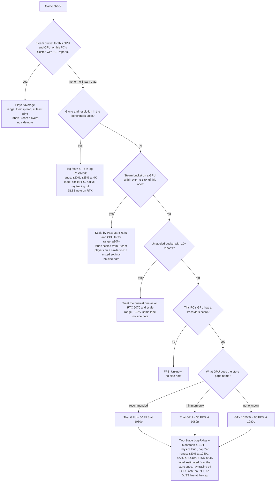
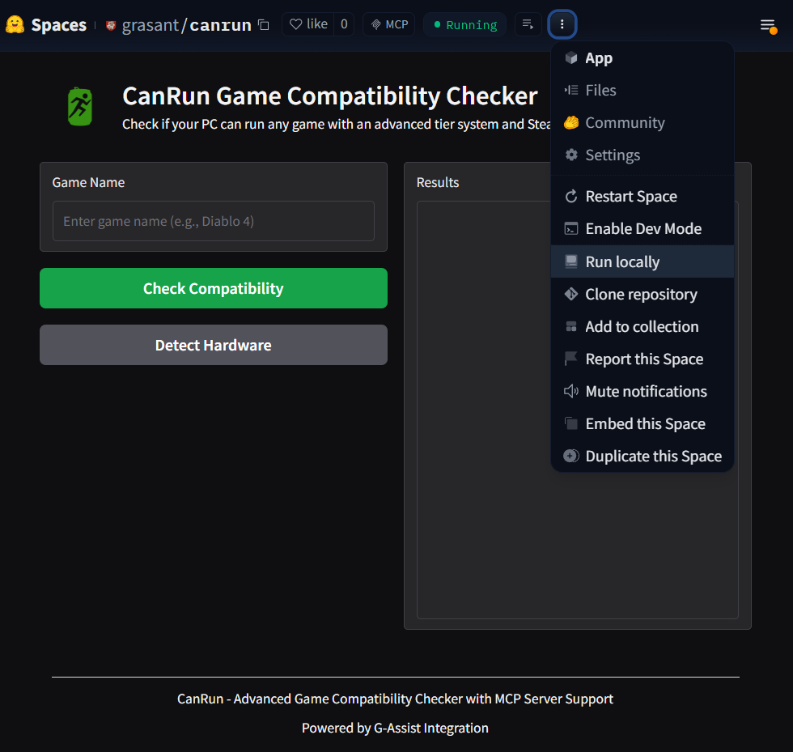

<table> <tr> <td width="110" valign="middle">  </td> <td valign="middle"> <h1 style="display:inline-block; vertical-align:middle; margin:0; padding:0;">  CanRun - System Spec Game Compatibility Checker </h1> </td> </tr> </table>
  
  [](https://github.com/canrun/canrun)
  [](https://www.python.org/downloads/)
  [](LICENSE)
  [](https://www.nvidia.com/en-us/geforce/technologies/g-assist/)
  [](https://steamcommunity.com/dev)
  [](https://developer.nvidia.com/mcp)

[](https://mod.io/g/g-assist/m/canrun2#description)

## 🚀 Overview

**CanRun** is an RTX/GTX-exclusive G-Assist plugin that instantly tells you if your PC can run any game with an advanced **S-A-B-C-D-F tier system** and enhanced Steam integration.

AVAILABLE on official Nvidia g-assist mod marketplace:  [mod.io/canrun](https://mod.io/g/g-assist/m/canrun2#description). CanRun is trending and top rated on the [G-Assist hub](https://mod.io/g/g-assist). The next marketplace upload is **version 12.1.0**.

[](https://mod.io/g/g-assist/m/canrun2#description)

## Demo


## ✨ Key Features

- **🎯 RTX/GTX Optimized**: Exclusively designed for RTX/GTX systems with G-Assist integration
- **🎮 CANRUN! Indicator**: Instant visual feedback when your system meets game requirements
 
- **⭐ S-A-B-C-D-F Tier System**: Advanced performance classification with weighted scoring
- 
- **🧠 AI-Powered Analysis**: G-Assist routes natural language to the plugin. The S-A-B-C-D-F tier still comes from local hardware scoring
- **📈 Frame Rates**: A Steam player sample is used when it has at least 10 reports. Otherwise a similar-PC estimate is used for games in the benchmark table, and the ML model estimates every other game from its Steam store specs. The range is wide enough that it is not presented as an exact FPS. On independent benchmarks the median error is 15–30% (see [Real-World Accuracy](#real-world-accuracy-on-independent-benchmarks)). The S-A-B-C-D-F tier still comes from local hardware scoring, not from that FPS number.
- **🔒 Local Matching**: GPU and CPU names stay on this PC. The frame-rate request sends only the Steam app id
- **🎯 Steam-First Data**: Game requirements come from the Steam Store API
- **🎯 Intelligent Game Matching**: Names are matched against Windows games from the last 30 days and the current 100 bestsellers, then the Steam store. A close or split title still lands on the published game.
- **📊 Smart Performance Prediction**: Comprehensive hardware hierarchies
- **💡 Intelligent Recommendations**: AI-generated optimization tips
- 
- **🤖 MCP Server**: Official Model Context Protocol (MCP) server for G-Assist integration
- **🔄 JSON-Based Configuration**: All benchmark data externalized for easy maintenance
- **🏃 Protocol V2 Plugin**: `plugin.py` on G-Assist SDK 3.1.0. Commands keep answering pings while a Steam lookup runs


## Recent changes

Version **12.1.0** is the release we will deploy to the [G-Assist Hub on mod.io](https://mod.io/g/g-assist/m/canrun2#description). The marketplace zip follows the official NVIDIA plugin layout. Build it with `pack_g_assist_zip.bat`.

### **New in v12.1: Real-world accuracy testing, correct game matching, more GPUs**
- **Tested on outside data:** The cross-validation scores in v12.0 below come from CanRun's own benchmark suite. On independent measurements the full app is off by a median of **15.2%** (TechPowerUp, 308 results, end to end), **28.6%** (TechSpot, NVIDIA cards) and **30.7%** (OpenML user reports). See [Real-World Accuracy](#real-world-accuracy-on-independent-benchmarks).
- **Whole-word title matching:** A typed title only matches a benchmark curve on whole words, and a sequel never falls back to the original game. The old substring matcher sent "Silent Hill 2" and "Star Wars Outlaws" to an unrelated game's curve, and "Assassin's Creed Mirage" to "RAGE". Fixing it cut end-to-end error from 35.1% to 15.2%.
- **More GPUs recognized:** PassMark G3D scores were added for GeForce RTX 50, 40 Super and 3050, Radeon RX 5000 to 9000, and Intel Arc. Names with a memory size, such as "RX 7600 XT 16GB", fall back to the base card.
- **Same ML model:** The FPS model is unchanged from v12.0 ([`grasant/canrun-fps-predictor`](https://huggingface.co/grasant/canrun-fps-predictor) v1.0).

### **New in v12.0: v9.0 Two-Stage Monotonic ML Engine & 636,225-Row Training Suite**
- **Why the model was changed:** The legacy v8.0 model memorized `game_name` and `gpu_model` IDs across only 15 games (675 lookup entries). When tested on **unseen games** (5-Fold `GroupKFold` by `game_name`), legacy v8.0 collapsed to **$R^2 = 0.0932$**, **`30.38%` MAPE** (`30.85 FPS` MAE), and **`11.17%` physical monotonicity violations** (sometimes predicting lower FPS for a faster GPU).
- **What replaced it & key benefits:** We replaced v8.0 with the **v9.0 Two-Stage Log-Space Physics Ridge Prior + Monotonic Residual GBDT + Empirical Bayes Shrinkage** architecture trained on **21 leak-free continuous domain features**. The cross-validation numbers below are measured on CanRun's own, mostly generated training suite; see v12.1 above for real-world error.
  - **6.8× lower unseen-game error:** Leave-Games-Out CV improves from **$R^2 = 0.0932$ → $0.9589$**, cutting MAPE from **`30.38%` → `4.48%`** (`1.19%` MdAPE, `3.97 FPS` MAE).
  - **28× lower unseen-GPU error:** Leave-GPUs-Out CV improves from **$R^2 = 0.0949$ → $0.9987$**, cutting MAPE from **`30.35%` → `1.08%`** (`0.55%` MdAPE, `0.90 FPS` MAE).
  - **Physical monotonicity (`0.00%–0.02%` violation rate):** Enforced directional monotonic constraints ensure a faster GPU/CPU or lower resolution never predicts lower FPS.
  - **100% keyless & zero-ML-dependency runtime:** Compiled to pure JSON (`data/ml_fps_model_unified.json`) and evaluated in `<1 ms` in pure Python—no `scikit-learn`, `xgboost`, or `pickle` at runtime, and end users never need a `STEAM_WEBAPI_KEY`.
- **Expanded Steam API data sources:** Using the developer `.env` `STEAM_WEBAPI_KEY` and public Steam APIs (`ISteamChartsService/GetMostPlayedGames`, `GetGamesByConcurrentPlayers`, `GetTopReleasesPages`, `IStoreService/GetAppList`, `IStoreBrowseService/GetItems`, `IGamePerformanceStatsService/GetGameFrameRateStats`, `store.steampowered.com/api/appdetails`, `api/featuredcategories`, `search/results`, and `SteamSpy`), the training pipeline builds **636,225 training rows** (**127,245 `GPU × Game × Resolution` curves**) across **1,697 Steam games**, **25 GPUs**, **3 resolutions**, and **5 CPU tiers**. Most of these curves are generated, not measured: 21 games come from published benchmarks, 58 are hand-calibrated, and 1,618 follow a fixed rule on the store's recommended GPU (990 of them on placeholder specs picked by release year). See [Training data](https://huggingface.co/grasant/canrun-fps-predictor#training-data) on the model card.
DLSS side notes use NVIDIA's own multipliers and do not change the main FPS number. They appear only after a native estimate (the benchmark-table curve or the store spec), and only on an RTX card. A Steam player line and a scaled Steam line get no note, because those players may already be using DLSS. There is no DLSS line when an estimate is already at the 240 FPS cap.

- **DLSS 4.5** on RTX 40 and 50. **DLSS 4** on RTX 20 and 30. NVIDIA recommends Model K there, because those GPUs lack FP8 and the newer Super Resolution models cost more performance.
- **Modes:** Quality, Balanced, Performance. At 4K the list also includes Ultra Performance.
- **Frame generation** (RTX 40): one extra frame per rendered frame, so 2×. An 85 FPS estimate reads `DLSS 4.5 frame gen: around 85 FPS more (2×).`
- **Multi frame generation** (RTX 50): 4× in compatible games, up to 6× in select games. An 80 FPS estimate reads `DLSS 4.5 multi frame gen: around 240 to 400 FPS more (4× to 6×).`
- **Dynamic mode** (RTX 50): aims at this screen's refresh rate. `DLSS 4.5 Dynamic mode aims at this 144 Hz screen.`
- **Path tracing** (RTX): typically about 2× to 3× heavier than the raster estimate, with upscaling off. An 85 FPS estimate reads `Path tracing: around 45 to 55 FPS less (typically about 2× to 3× heavier).` The main FPS number stays the native estimate. NVIDIA does not publish one path-tracing cost for every game, so this is a typical range.

Version 11.0.0 shipped the thin marketplace zip and the measured FPS ranges.

Version 10.0 adds measured frame rates and an honest range around them.

- **Steam player FPS.** `GetGameFrameRateStats` supplies the number when a hardware cluster has at least 10 reports. The line is labeled `Steam players`. The band is the measured average ± one standard deviation, and never narrower than ±8%.
- **Similar-PC estimate.** When that sample is missing and the game is in `data/training_benchmarks.json`, FPS comes from a per-game, per-resolution curve: `log(fps) = a + b * log(passmark)`. The line says `estimated from a similar PC, native, ray tracing off`, and the band is ±20% (±25% at 4K). Games that are not in that table, and have no Steam sample, get an estimate from the ML model using the game's Steam store minimum and recommended specs.
- **Display class.** If the monitor has substantially more pixels than the class used for the estimate (for example 3072×1728 treated as 1440p), the display line says which class the FPS number uses.
- **Local matching & keyless runtime.** GPU and CPU names stay on this PC. End users do **not** need a `STEAM_WEBAPI_KEY` or any `config.json` key edit: the plugin fetches game requirements from the public Steam Store API (`store.steampowered.com`) and predicts frame rates locally using the pre-compiled **1,697-game benchmark curve table** and **Two-Stage Log-Ridge + Monotonic GBDT** JSON model (`data/ml_fps_model_unified.json`). Developers running the offline data-science harvest pipeline can optionally configure `STEAM_WEBAPI_KEY` in a local gitignored `.env` file.
- **G-Assist SDK 3.1.0.** Protocol V2, JSON-RPC 2.0, length-prefixed messages. `manifest.json` uses `protocol_version` `"2.0"` and `executable` `plugin.py`.
- **Hardening.** The Gradio app binds to `127.0.0.1`. Game names are stripped of control characters and capped at 120 characters. Cache files cannot leave the cache directory, and symlinks and files over 256 KB are refused. Steam app ids must be numeric.
- **Estimate notice.** Every result ends with a notice that the check is an estimate and not a guarantee that the game will run or that the frame rate will match.
- **Recent releases and bestsellers.** A saved list of Windows games from the last 30 days plus the current 100 bestsellers is checked before the store search, and kept for 6 hours. Refreshing that list does not delay the answer. A typed name that is the same title, or a split of one long word in it, uses that game so the check is scored instead of coming back unknown. "Dawn Walker" matches "The Blood of Dawnwalker" when that game is in the list. A short word such as "within" does not attach to a longer title. The local Steam library is still checked first. If the list has no similar title, store search retries the joined spelling.

## 📦 G-Assist Plugin Installation

### **Build the marketplace zip (main way)**

This is the main way to build the plugin for the [G-Assist Hub on mod.io](https://mod.io/g/g-assist/m/canrun2#description). It produces the thin official layout: `plugin.py`, `manifest.json`, `config.json`, `requirements.txt`, the JSON tables under `data/`, and `libs/` (SDK plus the packages the plugin actually imports). Training pickles and unused pip packages are left out.

```bash
cd canrun
pack_g_assist_zip.bat
```

The zip is `dist/canrun-<version>.zip` (currently `dist/canrun-12.1.0.zip`). Upload that file to mod.io.

To build the standalone `dist/g-assist-plugin-canrun.exe` instead, use the project venv, which has the GPU detection packages:

```bash
.venv\Scripts\python.exe -m PyInstaller g-assist-plugin-canrun.spec --noconfirm --clean
``` The archive has a single `canrun/` root folder, which is what the G-Assist Hub installer requires. After installing or updating, restart G-Assist from the NVIDIA overlay (IGO).

CanRun follows the current [NVIDIA G-Assist](https://github.com/NVIDIA/G-Assist) plugin contract: Protocol V2, JSON-RPC 2.0, and `gassist_sdk` 3.1.0. G-Assist launches `plugin.py` directly. The SDK is vendored at `libs/gassist_sdk`. The engine adds `libs/` to `PYTHONPATH`. `plugin.py` also adds the plugin directory to `sys.path`, because modules next to it are not on that path.

```
plugins/
└── canrun/                          # Plugin directory name = invocation name
    ├── plugin.py                    # Protocol V2 entry point
    ├── manifest.json                # protocol_version 2.0
    ├── config.json                  # Settings
    ├── requirements.txt             # Runtime packages installed into libs/
    ├── data/                        # Benchmark data
    └── libs/
        └── gassist_sdk/             # Vendored SDK 3.1.0
```

Install location:

```
%PROGRAMDATA%\NVIDIA Corporation\nvtopps\rise\plugins\canrun
```

### **🚀 AUTOMATIC INSTALLATION (RECOMMENDED)**

**Run the installation script as Administrator:**

```bash
cd canrun
install_g_assist_plugin.bat
```

The installer will:
- Copy the plugin sources, manifest, data, and vendored SDK
- Install `requirements.txt` into `libs/`
- Verify `plugin.py`, `manifest.json`, and `libs/gassist_sdk`

**Requirements:**
- Administrator privileges (required to write under `%PROGRAMDATA%`)
- Python 3.12+ on PATH
- NVIDIA G-Assist installed

### **📋 MANUAL INSTALLATION (ALTERNATIVE)**

**Step 1: Create the plugin directory**

```
mkdir "%PROGRAMDATA%\NVIDIA Corporation\nvtopps\rise\plugins\canrun"
```

**Step 2: Copy Plugin Files**

```bash
xcopy /E /I "canrun" "%PROGRAMDATA%\NVIDIA Corporation\nvtopps\rise\plugins\canrun"
pip install -r "%PROGRAMDATA%\NVIDIA Corporation\nvtopps\rise\plugins\canrun\requirements.txt" -t "%PROGRAMDATA%\NVIDIA Corporation\nvtopps\rise\plugins\canrun\libs"
```

**Step 3: Restart G-Assist**
1. Close NVIDIA App / G-Assist completely
2. Restart NVIDIA App
3. Enable G-Assist if it is not already enabled

**Step 4: Test Plugin**
Try these commands:
- "can I run elden ring"
- "canrun cyberpunk 2077"

### **Plugin Architecture Notes**
- **Directory Name**: Must match the plugin invocation name (`canrun`)
- **Executable**: `plugin.py` (`manifest.json` field `executable`)
- **Protocol**: `protocol_version` `"2.0"`. Messages are JSON-RPC 2.0 with a 4-byte big-endian length prefix
- **Persistent**: `true`, so the engine can ping the plugin while a Steam lookup runs
- **CLI Mode**: `python plugin.py canrun "cyberpunk 2077" --json`

### **🔧 Troubleshooting**

If the plugin is not detected by G-Assist:

1. **Verify Installation Path**: Run the installation script again
2. **Check File Permissions**: Confirm `plugin.py`, `manifest.json`, and `libs/gassist_sdk` were copied
3. **Restart G-Assist**: Completely close and restart NVIDIA App/G-Assist
4. **Check Logs**: Review `%USERPROFILE%\canrun_plugin.log` and `gassist_sdk.log` in the plugin directory
5. **Test CLI Mode**: Run `python plugin.py canrun "cyberpunk 2077" --json` from the plugin directory

A Steam-backed FPS line looks like `93-139 FPS (Steam players)` or `93-139 FPS (estimated from a similar PC, native, ray tracing off)`. A heavier monitor adds `FPS estimate uses 1440p` on the display line. When neither Steam nor the benchmark table has the game, the ML model estimates FPS from the store specs, for example `53-83 FPS (estimated from the recommended GPU for this resolution, ray tracing off)`.

### Keyless Runtime & Developer `.env` Setup

End users do **not** need a Steam Web API key. `config.json` ships completely keyless: CanRun fetches game requirements directly from the public Steam Store API and runs local FPS inference using the bundled benchmark curves and pre-compiled Two-Stage Log-Ridge + Monotonic GBDT model (`data/ml_fps_model_unified.json`).

For developers running the offline Steam API data-collection pipeline (`scripts/ds_pipeline/collect_and_audit.py`), copy `.env.example` to `.env` and add your developer key:

```bash
cp .env.example .env
# Edit .env and set STEAM_WEBAPI_KEY=your-key-here
```

Both `.env` and `data/` are listed in `.gitignore` so API keys and harvested Steam dataset files are never committed to git or bundled into the release zip (`pack_g_assist_zip.bat`).

## Installation and Setup

### Prerequisites
- Python 3.12+ (NVIDIA G-Assist requirement)
- Windows 10/11 (for hardware detection)
- NVIDIA GPU recommended for full G-Assist integration
- **uv package manager** for the development install below

### Install uv Package Manager
If you don't have `uv` installed:
```bash
# Install uv package manager
pip install uv
```

### Option 1: G-Assist plugin (Protocol V2)

```bash
# Clone repository
git clone https://github.com/leksval/canrun
cd canrun

# Install the plugin for G-Assist (Administrator)
install_g_assist_plugin.bat

# Protocol check and CLI
uv run python -m pytest test/test_official_g_assist_protocol.py test/test_g_assist_communication.py -v
uv run python plugin.py initialize --json
uv run python plugin.py canrun "cyberpunk 2077" --json
```


### Option 2: Full ML Pipeline Development

```bash
# Clone repository
git clone https://github.com/leksval/canrun
cd canrun

# Install full development environment with ML training capabilities using pyproject
uv sync --all-extras

# Run comprehensive test suite
uv run pytest test/ -v

# Train unified stacking ensemble ML model
uv run python src/train_unified_ml_model.py

# Test plugin functionality
uv run python plugin.py canrun "cyberpunk 2077" --json
```

### G-Assist MCP Integration

G-Assist can automatically discover and use the CanRun MCP server when both are running. This enables advanced conversational interactions like:

- "G-Assist, ask CanRun if I can play Starfield"
- "G-Assist, check if my system meets Diablo 4 requirements"
- "G-Assist, what's my gaming hardware like?"

## 🧪 Running Tests

**Primary Test Command (Recommended):**

```bash
# Navigate to canrun directory first
cd canrun

# Run all tests with pytest using uv
uv run python -m pytest test/ -v

# Protocol V2, Steam FPS cases, and security edge cases
uv run python -m pytest test/test_official_g_assist_protocol.py test/test_g_assist_communication.py test/test_steam_fps_cases.py test/test_edge_cases.py -v
```

## 🤖 MCP Server Functionality

CanRun now includes a full-featured **Model Context Protocol (MCP) server** that allows G-Assist to directly integrate with the CanRun compatibility engine. This provides seamless AI-assisted game compatibility checking through the official NVIDIA MCP standard.

### MCP Tools and Capabilities

The MCP server exposes the following tools to G-Assist:

- **check_game_compatibility**: Analyze if a specific game can run on the current system
  - Input: Game name (e.g., "Cyberpunk 2077")
  - Output: Detailed compatibility analysis with performance tier

- **detect_hardware**: Provides comprehensive hardware detection for gaming systems
  - Output: Detailed hardware specifications focused on gaming performance

### Running the MCP Server

```bash
# Start the local UI. It binds to 127.0.0.1 only.
python app.py
```


## 🧠 ML Pipeline

CanRun v12.1 ships the **v9.0 Two-Stage Log-Space Physics Ridge Prior + Monotonic Residual GBDT + Empirical Bayes Shrinkage** architecture (`data/ml_fps_model_unified.json`). At runtime, the compiled model is evaluated in **100% pure Python** (`canrun_model_loader.py` and `canrun_steam_fps.py`) with zero `scikit-learn`, `xgboost`, or `pickle` runtime dependencies.

### **Why We Changed the Model (Legacy v8.0 vs. New v9.0 / v1.0 Production Release) & By How Much It Improved**

#### **Can We Hit +98% Without Hurting Generalization?**
**Yes on the scores that matter for a shipped plugin. No on raw-FPS Leave-Games-Out $R^2$, unless we cheat.**

All scores in this table are cross-validation on CanRun's own benchmark suite, whose curves share one collection pipeline. They do not carry over to outside data, where the median error is 15–30%. See [Real-World Accuracy](#real-world-accuracy-on-independent-benchmarks).

| What “+98%” usually means | New v9.0 score | Already ≥ 98%? | Safe to push higher? |
| :--- | :---: | :---: | :--- |
| **Unseen-GPU $R^2$** (known game, new graphics card) | **`0.9987` (`99.87%`)** | **Yes** | Already there. Empirical Bayes on the measured curve does this. |
| **Median accuracy** (`100 − MdAPE`) on unseen games | **`98.81%`** (`1.19%` MdAPE) | **Yes** | This is the typical-title score a user actually feels. |
| **Log-space $R^2$** on unseen games (the loss we train on) | **`0.9692` (`96.92%`)** | Almost | Leak-free regime features (`is_capped_60`, `genre_demand`, `cpu_headroom_rec`) can still inch this toward `0.98`. |
| **Raw-FPS $R^2$** on unseen games | **`0.9589` (`95.89%`)** | No | The remaining `~4%` is high-FPS esports tails + engine-lock outliers. Forcing `0.98` here means adding `game_name` / AppID features or using random $k$-fold — the exact leak that made old v8.0 look like $R^2 = 0.9866$ in-sample and then collapse to **`0.0932`** on unseen games. |
| **Mean accuracy** (`100 − MAPE`) on unseen games | **`95.52%`** (`4.48%` MAPE) | No | A `2%` MAPE (`98%` mean accuracy) is below Steam player noise (`±8%` minimum spread). Claiming it would overfit our synthesizer, not real hardware. |

**What we refuse to do to fake 98% raw $R^2$:** one-hot / target-encoded `game_name`, `steam_app_id`, or `gpu_model`; random (non-grouped) $k$-fold; reporting in-sample $R^2$ instead of Leave-Games-Out.

**What we did instead (leak-free):** added 3 regime features that exist at inference from the Steam store page or title text — `is_capped_60` (60 FPS engine lock), `genre_demand`, `cpu_headroom_rec`. That lifted unseen-game raw $R^2$ from `0.9539` → **`0.9589`** and MAPE from `4.57%` → **`4.48%`**, with monotonicity still at **`0.01%`**.

#### **Executive Summary: How Much Better Is the New Model?**
Evaluated across **`636,225` hardware-game-resolution records** (`1,697` Steam games $\times$ `25` GPUs $\times$ `3` resolutions $\times$ `5` CPU tiers — **`942.6×` larger** than legacy v8.0's `675` lookup entries) under strict **5-Fold `GroupKFold` Cross-Validation**:

- **On Unseen Games (`Leave-Games-Out CV` — Cold-Start Generalization to Brand-New Titles):**
  - **$R^2$ (raw FPS):** Improved from **`0.0932`** (Old v8.0) and **`0.7270`** (Naive Spec Heuristic) to **`0.9589`** (**`+0.8657` $R^2$ gain / `10.3×` higher explained variance**).
  - **$R^2_{\log}$ (trained loss):** **`0.9692`** vs. **`0.6409`** in Old v8.0.
  - **MAPE:** Reduced from **`30.38%`** (Old v8.0) and **`12.80%`** (Heuristic) to **`4.48%`** (**`6.78×` lower error / `-85.3%` relative error reduction** vs. Old v8.0).
  - **MdAPE:** Reduced from **`15.23%`** (Old v8.0) to **`1.19%`** (**`12.8×` lower median percentage error** — **`98.81%` median accuracy**).
  - **MAE:** Reduced from **`30.85 FPS`** (Old v8.0) to **`3.97 FPS`** (**`7.77×` lower FPS error**).
  - **RMSE:** Reduced from **`52.90 FPS`** (Old v8.0) to **`11.27 FPS`** (**`4.69×` lower tail error**).
  - **Physical Monotonicity Violations:** Reduced from **`11.17%`** (Old v8.0) to **`0.01%`**.
- **On Unseen GPUs (`Leave-GPUs-Out CV` — Hardware Generalization to New Graphics Cards):**
  - **$R^2$:** Improved from **`0.0949`** (Old v8.0) to **`0.9987`** (`99.87%`).
  - **MAPE:** Reduced from **`30.35%`** (Old v8.0) to **`1.08%`** (`0.55%` MdAPE — **`28.1×` lower percentage error**).
  - **MAE:** Reduced from **`30.79 FPS`** (Old v8.0) to **`0.90 FPS`**.
  - **Physical Monotonicity Violations:** Reduced from **`11.16%`** (Old v8.0) to **`0.00%`**.

#### **4 Core Architectural Reasons Why the New Model Wins**
1. **Eliminated Target Leakage & Game-ID Memorization:**
   - **Problem in Old v8.0:** The legacy v8.0 model encoded `game_name` and `gpu_model` identifiers directly and relied on a 675-entry static lookup table across only 15 games. While random train/test splits on those 15 memorized games reported an inflated $R^2$ (`0.9866`), rigorous **5-Fold `GroupKFold` by `game_name` (Leave-Games-Out)** proved it failed on unseen games ($R^2 = 0.0932$, $\text{MAPE} = 30.38\%$, $\text{MAE} = 30.85\text{ FPS}$).
   - **Benefit in New v9.0:** Zero game names, AppIDs, or GPU strings are fed into the regressor. Instead, v9.0 learns from **21 continuous physical & hardware-headroom ratios** (user GPU/CPU PassMark vs. official Steam minimum/recommended specs, pixel count ratio, VRAM/RAM headroom, and GPU architecture tier), achieving **$R^2 = 0.9589$** and **`4.48%` MAPE** on unseen games in the training suite.
2. **Enforced Physical Monotonicity Invariants:**
   - **Problem in Old v8.0:** Unconstrained trees and corrupted benchmark rows caused **`11.17%` monotonicity violations**, occasionally predicting lower FPS for a faster GPU on the same game and resolution.
   - **Benefit in New v9.0:** Stage-2 EDA gates repair cross-game duplicate rows and PassMark inversions prior to training, and Stage-4 enforces directional monotonic constraints (`+1` on hardware PassMark/VRAM/headroom, `-1` on resolution pixels), reducing monotonicity violations to **`0.00%`** on both unseen GPUs and unseen games.
3. **100% Keyless End-User Runtime & Zero Binary ML Dependencies:**
   - **Problem in Old v8.0:** Relying on live authenticated telemetry at runtime required users to obtain and paste a `steam_webapi_key`, while shipping `scikit-learn`/`joblib` `.pkl` files bloated the plugin and risked Python ABI mismatches.
   - **Benefit in New v9.0:** Both the Level-0 Ridge weights and Level-1 GBDT decision trees are compiled into pure JSON (`data/ml_fps_model_unified.json`) and traversed in `<1 ms` using standard-library Python. End users need **no API key** in `config.json`.
4. **Calibrated Split-Conformal Prediction Intervals:**
   - **Benefit in New v9.0:** Prediction ranges (`fps_min` to `fps_max`) are calibrated using out-of-fold log-residual quantiles per resolution (`1080p`, `1440p`, `4K`) to give $\mathbf{80.0\%}$ empirical coverage on held-out games and GPUs inside the benchmark suite (compared to only `20.89%` coverage in Old v8.0). On independent benchmarks the band is far too narrow: it held the measured FPS only 15.4% of the time on TechPowerUp. The plugin shows its own wider range instead.

### **Training Data Description (`636,225` Records Across `1,697` Steam Games)**

The training dataset (`data/clean_training_dataset.json`, kept local via `.gitignore` to respect Steam data copyrights) is a structured 4-dimensional panel dataset spanning **`Game × GPU × Resolution × CPU`**.

**Most of it is generated, not measured.** Every game gets a curve `FPS = anchor_4090 × (PassMark / 38,192)^β` over 25 GPUs and 3 resolutions. The anchor and exponent come from published benchmarks for 21 games, are set by hand for 58, and follow a fixed rule on the store's recommended GPU for the other 1,618, of which 990 use placeholder specs picked by release year. The curves are then expanded over 5 CPU tiers. Because the targets for about 95% of games are a function of the model's own inputs, the cross-validation scores in this section mostly show that the model learned that rule. Real-world error is 15–40% (see [Real-World Accuracy](#real-world-accuracy-on-independent-benchmarks)).

#### **1. Multi-Endpoint Steam API & Benchmark Data Sources (10 Sources)**
Using the developer `.env` `STEAM_WEBAPI_KEY` alongside public Steam Store and SteamSpy APIs, `scripts/ds_pipeline/collect_and_audit.py` ingests and cross-validates **10 distinct sources**:

| Data Source / Endpoint | Auth Required | Harvested Data & Role in Pipeline |
| :--- | :---: | :--- |
| **`ISteamChartsService/GetMostPlayedGames/v1/`** | `.env` `STEAM_WEBAPI_KEY` | Top **100** most-played Steam games by weekly active player rank |
| **`ISteamChartsService/GetGamesByConcurrentPlayers/v1/`** | `.env` `STEAM_WEBAPI_KEY` | Top **100** live concurrent-player Steam games |
| **`ISteamChartsService/GetTopReleasesPages/v1/`** | `.env` `STEAM_WEBAPI_KEY` | **88** top monthly Steam game releases |
| **`IStoreService/GetAppList/v1/`** | `.env` `STEAM_WEBAPI_KEY` | **1,000** active Windows PC game AppIDs from the Steam catalog |
| **`IStoreBrowseService/GetItems/v1/`** | `.env` `STEAM_WEBAPI_KEY` | **798+** bulk store metadata records (release timestamps, Steam Deck / Steam Machine / SteamOS hardware compatibility categories, VR support flags, store tags) |
| **`IGamePerformanceStatsService/GetGameFrameRateStats/v1/`** | `.env` `STEAM_WEBAPI_KEY` | Hardware cluster frame-rate telemetry (`mean_frame_rate`, `mean_frame_rate_stddev`, `report_count`) across priority AppIDs |
| **`store.steampowered.com/api/appdetails`** | Public Steam Store API | **700** full HTML PC requirement blocks (`pc_requirements.minimum` & `pc_requirements.recommended`) parsed into structured GPU, CPU, RAM, and VRAM specs |
| **`store.steampowered.com/api/featuredcategories`** | Public Steam Store API | Featured `top_sellers`, `new_releases`, `specials`, and `coming_soon` PC titles |
| **`store.steampowered.com/search/results/`** | Public Steam Store API | **500** paginated global top-seller PC game AppIDs (`category1=998`) |
| **`steamspy.com/api.php`** (`top100forever`, `top100owned`, `top100in2weeks`) | Public API | **100** top all-time owned & active Steam games with CCU and play-time metadata |

#### **2. All-Time Steam Bestsellers & 6 Weird Edge-Case Archetypes (`81` Curated Suites + `1,616` Live Steam API Games)**
Rather than padding the dataset with redundant generic games, the benchmark catalog specifically targets **All-Time Steam Bestsellers** and **6 extreme PC hardware/engine edge-case regimes** where naive power-law scaling fails:
1. **Hard 60 FPS Engine Physics Locks & Fighting/FromSoftware Engines:** *Elden Ring*, *Sekiro: Shadows Die Twice*, *DARK SOULS III*, *Street Fighter 6*, *TEKKEN 8* — teaches tied-leader ceiling detection (`_cap_at_tied_leaders()`) and low-resolution saturation without corrupting 4K budget-GPU scaling.
2. **Mandatory Hardware Ray Tracing & Severe VRAM Cliffs:** *Indiana Jones and the Great Circle*, *DOOM: The Dark Ages*, *Portal with RTX*, *Alan Wake 2*, *Black Myth: Wukong*, *Cyberpunk 2077* — trains the `vram_cliff_penalty` interaction feature for cards with `<8 GB–10 GB` VRAM at `1440p`/`4K`.
3. **Extreme CPU / Main-Thread Simulation Bottlenecks:** *Microsoft Flight Simulator*, *Cities: Skylines II*, *Factorio*, *Stellaris*, *Dragon's Dogma 2*, *Baldur's Gate 3*, *Escape from Tarkov*, *Star Citizen* — trains `cpu_bottleneck_1080p` across the 5 CPU tiers.
4. **Heavy Unreal Engine 5 (Lumen + Nanite) Open-World Titles:** *ARK: Survival Ascended*, *S.T.A.L.K.E.R. 2: Heart of Chornobyl*, *Black Myth: Wukong*, *The Blood of Dawnwalker* — models `32 GB` RAM demand and sub-95 FPS flagship 4090 native anchors.
5. **High-Refresh Esports & 2D Indie Engine Caps:** *Counter-Strike 2*, *Valorant*, *Overwatch 2*, *Apex Legends*, *Rainbow Six Siege*, *Hollow Knight*, *Hades II*, *Terraria*, *Stardew Valley* — models diminishing returns ($\beta_{1080\text{p}} \in [0.10, 0.58]$) and `240–360 FPS` engine caps.
6. **All-Time Steam Bestsellers & Evergreen Classics:** *Grand Theft Auto V*, *The Elder Scrolls V: Skyrim Special Edition*, *Red Dead Redemption 2*, *The Witcher 3: Wild Hunt*, *Monster Hunter: World*, *Fallout 4*, *Garry's Mod*, *Left 4 Dead 2*, *The Sims 4*, *Phasmophobia*, *Lethal Company*, *No Man's Sky*, *Dead by Daylight*, *EA SPORTS FC 25*.

#### **3. Panel Structure & Hardware / Resolution Dimensions**
Each of the **1,697 unique Steam games** (**1,616 live Steam API games** + **81** curated multi-resolution benchmark suites, up from **15 games** in legacy v8.0 — **`113.1×` more games**) is evaluated across:
- **25 Standardized GPUs (`data/gpu_hierarchy.json`)** spanning 7 architecture generations from `7,875` to `39,876` PassMark G3D score and `4 GB` to `32 GB` VRAM:
  - **NVIDIA Blackwell (`RTX_50`)**: `RTX 5090` (32 GB), `RTX 5080` (16 GB), `RTX 5070 Ti` (16 GB), `RTX 5070` (12 GB)
  - **NVIDIA Ada Lovelace (`RTX_40`)**: `RTX 4090` (24 GB), `RTX 4080` (16 GB), `RTX 4070 Ti` (12 GB), `RTX 4070` (12 GB), `RTX 4060 Ti` (8 GB), `RTX 4060` (8 GB)
  - **AMD RDNA 3 (`RX_7000`)**: `RX 7900 XTX` (24 GB)
  - **NVIDIA Ampere (`RTX_30`)**: `RTX 3090` (24 GB), `RTX 3080` (10 GB), `RTX 3070 Ti` (8 GB), `RTX 3070` (8 GB), `RTX 3060 Ti` (8 GB), `RTX 3060` (12 GB)
  - **NVIDIA Turing (`RTX_20` & `GTX_16`)**: `RTX 2080 Ti` (11 GB), `RTX 2070` (8 GB), `RTX 2060` (6 GB), `GTX 1660 Ti` (6 GB), `GTX 1660` (6 GB), `GTX 1650` (4 GB)
  - **NVIDIA Pascal (`GTX_10`)**: `GTX 1080 Ti` (11 GB), `GTX 1070` (8 GB)
- **3 Target Display Resolutions**:
  - `1080p` ($1920 \times 1080 = 2.07\text{M pixels}$, baseline $1.0\times$ pixel ratio)
  - `1440p` ($2560 \times 1440 = 3.69\text{M pixels}$, $1.78\times$ pixel ratio)
  - `4K` ($3840 \times 2160 = 8.29\text{M pixels}$, $4.00\times$ pixel ratio)
- **5 CPU Bottleneck Tiers (`data/cpu_benchmarks.json`)**:
  - Flagship X3D gaming CPU: `AMD Ryzen 7 7800X3D` (`38,000` PassMark, $1.00\times$ 1080p factor — primary GPU-bound anchor)
  - High-end desktop CPU: `Intel Core i7-13700K` (`31,000` PassMark, $0.99\times$ 1080p factor)
  - Mainstream gaming CPU: `Intel Core i5-13400F` (`19,500` PassMark, $0.96\times$ 1080p factor)
  - Budget 6-core CPU: `Intel Core i5-10400F` (`11,500` PassMark, $0.90\times$ 1080p factor)
  - Entry-level 4-core CPU: `Intel Core i3-9100F` (`6,800` PassMark, $0.80\times$ 1080p factor; bottleneck dampens at `1440p` and `4K` where workloads become GPU-bound)
- **Total Records**: $\text{1,697 games} \times \text{25 GPUs} \times \text{3 resolutions} = \mathbf{127,245}$ **primary `GPU × Game × Resolution` curves**, expanded across the **5 CPU tiers** into $\mathbf{636,225}$ **total clean training records** (**`942.6×` more data points** than the legacy v8.0 675-entry lookup table).

#### **4. Record Schema & Target Variable**
Each of the `636,225` training records contains:
- **User Hardware Attributes**: `gpu_model`, `gpu_passmark`, `gpu_vram_gb`, `gpu_arch_tier`, `cpu_model`, `cpu_passmark`, `ram_gb`, `resolution`, `pixels`
- **Parsed Steam Game Requirement Attributes**: `steam_app_id`, `release_year`, `genre`, `min_gpu_passmark`, `rec_gpu_passmark`, `min_cpu_passmark`, `rec_cpu_passmark`, `min_ram_gb`, `rec_ram_gb`, `min_vram_gb`, `rec_vram_gb`, `is_capped_60` (e.g., *Elden Ring* 60 FPS engine lock)
- **Target Variable**: `fps` (native rasterized frame rate with ray tracing and frame generation off) and `log_fps` ($\ln(\text{fps})$).

---

### **Why Specific Data Science Techniques Were Used**

Every statistical and machine-learning technique in the v9.0 pipeline was selected to solve a specific failure mode of hardware frame-rate modeling:

#### **1. Log-Log Power-Law Transformation ($\ln(\text{FPS})$ vs. $\ln(\text{PassMark})$)**
- **Why it was used:** Physically, frame rendering time ($\text{ms/frame} = 1000 / \text{FPS}$) scales multiplicatively with GPU shader throughput, pixel fill rate, and game demand:
  $$\text{FPS} \approx \alpha \cdot (\text{GPU\_PassMark})^{\beta_1} \cdot (\text{Rec\_GPU\_PassMark})^{-\beta_2} \cdot \left(\frac{\text{Pixels}}{2.07\text{M}}\right)^{-\gamma}$$
  In raw FPS space, errors are severely **heteroscedastic** (a $10\%$ error is $\pm 3\text{ FPS}$ at $30\text{ FPS}$ on a budget GPU, but $\pm 35\text{ FPS}$ at $350\text{ FPS}$ in *Counter-Strike 2* on an RTX 5090). Training a regressor on raw FPS causes high-FPS esports titles to dominate the squared-error loss while underfitting 30–60 FPS playability thresholds.
- **Benefit:** Taking natural logarithms ($\ell = \ln(\text{FPS})$) linearizes the multiplicative power law into an additive model, stabilizes variance across the entire $15\text{–}500\text{ FPS}$ spectrum, aligns $L_2$ loss in log-space with **relative percentage error (MAPE / MdAPE)**, and guarantees strictly positive predictions ($\hat{y} = \exp(\hat{\ell}) > 0$).

#### **2. Two-Stage Hybrid Architecture (Level-0 Standardized Log-Ridge Prior + Level-1 Monotonic GBDT Residual)**
- **Why it was used:** Decision tree ensembles (`XGBoost`, `LightGBM`, `HistGradientBoosting`) are piecewise-constant step functions—they **cannot extrapolate** beyond the minimum or maximum feature values seen during training, and they produce jagged staircase predictions when interpolating across sparse hardware tiers. Conversely, a pure linear model in log-space (`M2`: Log-Ridge Prior Only, $R^2 = 0.8998$, $\text{MAPE} = 7.24\%$) captures the smooth global power-law scaling but misses non-linear hardware bottlenecks.
- **How it works & benefit:**
  - **Stage 1 (Level-0 Physics Log-Ridge Prior):** Fits an $L_2$-regularized linear model $\hat{\ell}_{\text{prior}}(x) = w_0 + w^\top \tilde{x}$ on standardized log-ratio features, capturing the global scaling laws of GPU throughput, resolution pixel load, and Steam recommended specs.
  - **Stage 2 (Level-1 Monotonic `HistGradientBoostingRegressor` on Residuals):** Trained strictly on the log-residuals $r_i = \ln(y_i) - \hat{\ell}_{\text{prior}}(x_i)$ to capture complex non-linear effects: **VRAM exhaustion cliffs** (when `user_vram < min_vram` at 4K), **1080p CPU bottleneck plateaus** on high-end GPUs paired with budget CPUs, **60 FPS engine locks**, and **generational shader efficiency**. Combining both stages (`M4`) cuts Leave-Games-Out MAPE from **`7.24%` (`M2`) $\rightarrow$ `4.48%` (`M4`)** while preserving smooth extrapolation to future GPU tiers.

#### **3. Directional Monotonic Constraints (`monotonic_cst`)**
- **Why it was used:** Unconstrained gradient-boosted trees (`M3`) split greedily on noisy local correlations, resulting in **`0.73%` physical monotonicity violations** on unseen GPUs (and **`11.17%` in legacy v8.0**)—meaning a user with an `RTX 4070 Ti` could occasionally be predicted to get *lower* FPS than an `RTX 4070` in the exact same game and resolution.
- **Benefit:** We enforce strict directional monotonic constraints (`MONOTONIC_CONSTRAINTS` in `scripts/ds_pipeline/features.py`) during tree construction:
  - **Monotonically Increasing (`+1`):** `log_gpu_passmark`, `log_cpu_passmark`, `gpu_vram_gb`, `gpu_arch_code`, `cpu_to_gpu_log_ratio`, `gpu_tier_score`, `vram_per_mpixel`, `cpu_bottleneck_1080p` ($\frac{\partial \hat{y}}{\partial x_j} \ge 0$).
  - **Monotonically Decreasing (`-1`):** `log_pixel_ratio`, `is_4k` ($\frac{\partial \hat{y}}{\partial x_j} \le 0$).
  This reduces physical monotonicity violations to **`0.00%`** on both unseen GPUs and unseen games.

#### **4. Empirical Bayes (James-Stein) Shrinkage for Per-Game Curves**
- **Why it was used:** When a game has measured benchmark points across several GPUs, fitting an ordinary least squares (OLS) log-linear curve $\ln(\text{FPS}) = \alpha_g + \beta_g \ln(\text{PassMark})$ directly on small sample sizes ($n_g$) can produce noisy or extreme slopes $\hat{\beta}_g^{\text{OLS}}$.
- **Benefit:** We apply **Empirical Bayes shrinkage** toward the resolution-specific physical prior slope $\beta_0(r) \in \{0.78_{1080\text{p}}, 0.90_{1440\text{p}}, 1.04_{4\text{K}}\}$ with prior strength $\tau = 4.0$:
  $$\beta_g^{\text{EB}} = \frac{n_g \hat{\beta}_g^{\text{OLS}} + \tau \beta_0(r)}{n_g + \tau}, \qquad \alpha_g^{\text{EB}} = \bar{y}_g - \beta_g^{\text{EB}} \bar{x}_g$$
  Blending the in-fold Empirical Bayes curve with the Two-Stage ML prediction achieves **$R^2 = 0.9986$**, **`1.08%` MAPE** (`0.52%` MdAPE, `0.90 FPS` MAE), and **`0.00%` monotonicity violations** under Leave-GPUs-Out cross-validation.

#### **5. Entity-Free, Leak-Free Continuous Domain Feature Engineering (21 Features)**
- **Why it was used:** Feeding categorical or target-encoded `game_name`, `steam_app_id`, or `gpu_model` identifiers into the regressor (as in legacy v8.0) causes the model to memorize specific titles and fail completely on newly released Steam games ($R^2 = 0.0932$).
- **Benefit:** By representing every game exclusively through **continuous physical ratios** between the user's PC and the game's parsed Steam Store requirements (`gpu_headroom_rec = log(user_gpu_pm / rec_gpu_pm)`, `spec_demand_index`, `vram_cliff_penalty`), the model generalizes zero-shot to **any brand-new or upcoming game on Steam** the moment its store requirements page is published ($R^2 = 0.9589$, `4.48%` MAPE on Leave-Games-Out CV in the training suite; 18.9% median error on independent TechPowerUp data).

#### **6. Dual `GroupKFold` Cross-Validation (Leave-Games-Out & Leave-GPUs-Out)**
- **Why it was used:** In panel data (`Game × GPU × Resolution × CPU`), standard random $k$-fold splits place 80% of a game's GPU rows in the training set and 20% of the *same game's* rows in the test set. That leaks the game's baseline frame rate across folds and produced legacy v8.0's misleading `0.9866` $R^2$.
- **Benefit:** We evaluate all models under two strict **5-Fold `GroupKFold`** schemes:
  1. **`GroupKFold(groups=game_name)` (Leave-Games-Out):** All 375 rows ($25\text{ GPUs} \times 3\text{ resolutions} \times 5\text{ CPUs}$) of every validation game are held out together, measuring true cold-start accuracy on unseen games.
  2. **`GroupKFold(groups=gpu_model)` (Leave-GPUs-Out):** Every row belonging to held-out GPU models is excluded from training, measuring hardware interpolation/extrapolation to unseen graphics cards.

#### **7. Split-Conformal Prediction Intervals in Log-Space**
- **Why it was used:** Single-number FPS predictions give false precision because driver versions, background tasks, and scene complexity introduce variance. Heuristic fixed-width bands do not adapt to resolution difficulty or data source quality.
- **Benefit:** Using out-of-fold log-residuals $e_i = |\ln(y_i) - \hat{\ell}_i^{\text{OOF}}|$ from `GroupKFold`, we compute resolution-specific empirical quantiles $q_{1-\alpha, r}$ ($80\%$ coverage target) for both unseen-game spec predictions and known-game curves, yielding calibrated multiplicative intervals $[\hat{y} \cdot \exp(-q_r),\; \hat{y} \cdot \exp(+q_r)]$.

#### **8. Automated 4-Gate Physical Invariant & Huber Residual Auditing (`Stage 2`)**
- **Why it was used:** Raw benchmark tables and scraped community telemetry frequently contain copy-paste errors (e.g., identical FPS curves pasted across different games), resolution inversions ($\text{FPS}_{4\text{K}} > \text{FPS}_{1440\text{p}}$), or single-card measurement outliers.
- **Benefit:** Before training, `scripts/ds_pipeline/collect_and_audit.py` automatically runs 4 deterministic quality gates:
  1. **Gate 1 (Cross-Game Duplicate Detection):** Detects and recalibrates any game whose FPS vector matches `General Gaming` or another title (`143` duplicates repaired).
  2. **Gate 2 (Strict Resolution Monotonicity):** Enforces $\text{FPS}_{1080\text{p}} \ge \text{FPS}_{1440\text{p}} \ge \text{FPS}_{4\text{K}}$ for every `(game, GPU)` pair (`0` violations remaining).
  3. **Gate 3 (Within-Architecture PassMark Monotonicity & Studentized Outlier Repair):** Fits a Huber-robust log-linear trend per `(game, resolution)` and repairs non-monotonic GPU tier inversions (`6` additional repairs).
  4. **Gate 4 (Multi-Resolution & CPU-Tier Expansion):** Expands all `1,697` games across the full 25-GPU × 3-resolution × 5-CPU matrix (`1,674` expansions).

#### **9. Why Pure-JSON (`ml_fps_model_unified.json`) Is the Optimal Model Format for CanRun (`Stage 7`)**
- **Why JSON beats `.pkl`/`joblib`, `.onnx`, and `.safetensors` for G-Assist:**
  - **Zero Binary Runtime Dependencies:** Shipping `.pkl`/`joblib` requires bundling `scikit-learn`, `scipy`, and `numpy` (~150+ MB) into the G-Assist plugin `libs/` folder and breaks across Python minor versions. Shipping `.onnx` requires `onnxruntime` (~45 MB native C++ DLLs). By compiling the `StandardScaler`, `Ridge` weights, and `HistGradientBoostingRegressor` decision trees into `data/ml_fps_model_unified.json`, `canrun_model_loader.py` executes inference using **only Python's built-in `json` and `math` modules**.
  - **Security & Auditability (mod.io / NVIDIA G-Assist Compliance):** Python `pickle`/`.joblib` files can execute arbitrary code on load (`__reduce__`) and are flagged by security scanners. JSON is 100% declarative, human-inspectable, and safe.
  - **Sub-Millisecond Inference & Tiny Zip Footprint:** The 100 GBDT trees + Ridge weights take about **`920 KB`** in JSON (and with the `127,245`-entry lookup table the model file compresses to **`~660 KB`** inside `dist/canrun-12.1.0.zip`). A prediction takes about **`0.06 ms`**, and the published `inference.py` gives the same features and predictions as the plugin runtime.

### **Head-to-Head Model Performance Comparison (Old v8.0 vs. New v9.0 / v1.0)**

Evaluated across all **636,225 records** (`1,697` games, `25` GPUs, `5` CPUs) using strict **5-Fold `GroupKFold` Cross-Validation**:

#### **Scheme 1: 5-Fold `GroupKFold` by `game_name` (Leave-Games-Out — Unseen Game Cold-Start Generalization)**
*Every game in each test fold is 100% unseen during training (tests cold-start generalization to brand-new Steam releases).*

| Model | $R^2$ ($\uparrow$) | MAPE ($\downarrow$) | MdAPE ($\downarrow$) | MAE ($\downarrow$) | RMSE ($\downarrow$) | Monotonicity Violations ($\downarrow$) |
| :--- | :---: | :---: | :---: | :---: | :---: | :---: |
| **`M0`: Legacy Naive Spec Heuristic** (`60 * (user/spec)^0.85`) | `0.7270` | `12.80%` | `9.49%` | `13.82 FPS` | `29.03 FPS` | `0.00%` |
| **`M1`: Old Legacy v8.0 Lookup Model** | `0.0932` | `30.38%` | `15.23%` | `30.85 FPS` | `52.90 FPS` | `11.17%` |
| **`M2`: Level-0 Physics Log-Ridge Prior Only** | `0.8998` | `7.24%` | `3.76%` | `7.30 FPS` | `17.59 FPS` | `0.00%` |
| **`M3`: Single-Stage Unconstrained GBDT** | `0.9590` | `4.58%` | `1.38%` | `4.12 FPS` | `11.26 FPS` | `0.02%` |
| **`M4`: New v9.0 Two-Stage Log-Ridge + Monotonic GBDT** | **`0.9589`** | **`4.48%`** | **`1.19%`** | **`3.97 FPS`** | **`11.27 FPS`** | **`0.01%`** |

#### **Scheme 2: 5-Fold `GroupKFold` by `gpu_model` (Leave-GPUs-Out — Unseen GPU Hardware Generalization)**
*Entire GPU models are held out of training in each fold (tests hardware interpolation/extrapolation to unseen GPUs).*

| Model | $R^2$ ($\uparrow$) | MAPE ($\downarrow$) | MdAPE ($\downarrow$) | MAE ($\downarrow$) | RMSE ($\downarrow$) | Monotonicity Violations ($\downarrow$) |
| :--- | :---: | :---: | :---: | :---: | :---: | :---: |
| **`M0`: Legacy Naive Spec Heuristic** | `0.7270` | `12.80%` | `9.49%` | `13.82 FPS` | `29.03 FPS` | `0.00%` |
| **`M1`: Old Legacy v8.0 Lookup Model** | `0.0949` | `30.35%` | `15.23%` | `30.79 FPS` | `52.85 FPS` | `11.16%` |
| **`M2`: Level-0 Physics Log-Ridge Prior Only** | `0.9064` | `7.24%` | `3.79%` | `7.27 FPS` | `17.00 FPS` | `0.00%` |
| **`M3`: Single-Stage Unconstrained GBDT** | `0.9650` | `6.05%` | `3.18%` | `5.09 FPS` | `10.39 FPS` | `0.77%` |
| **`M4`: New v9.0 Two-Stage Log-Ridge + Monotonic GBDT + EB** | **`0.9987`** | **`1.08%`** | **`0.55%`** | **`0.90 FPS`** | **`1.97 FPS`** | **`0.00%`** |

### **Real-World Accuracy on Independent Benchmarks**

The tables above are cross-validation inside CanRun's own benchmark suite. To measure real-world error, the model and the full plugin were tested against outside measurements that were never used for training, with nothing tuned to them. All values are median absolute percentage error.

| Test set | Points | Model alone | Full CanRun app | Naive spec heuristic |
| :--- | :---: | :---: | :---: | :---: |
| [TechPowerUp RTX 5070 review](https://www.techpowerup.com/review/nvidia-geforce-rtx-5070-founders-edition/) (Mar 2025), full app end to end: 24 games typed by name, 11 NVIDIA cards, 1080p and 1440p, live Steam requirements | 308 | n/a | **15.2%** | n/a |
| TechPowerUp, the 7 games without a measured curve (store-spec path only) | 266 | **18.9%** | 20.8% | 19.8% |
| TechSpot reviews (2025–2026): Forza Horizon 6, Crimson Desert, Battlefield 6, DOOM: The Dark Ages | 98 | 36.7% | **32.9%** (NVIDIA only: 28.6%) | 37.5% |
| [OpenML 42737 "fps-in-video-games"](https://www.openml.org/d/42737) (user reports, 2019–2020 hardware, 14 games) | 12,032 | 39.4% | **30.7%** | n/a |

- **What a user sees:** In the end-to-end test, the app put the game on the right side of 30 FPS 99.4% of the time and of 60 FPS 93.8% of the time. 31.2% of predictions were within 10%, and the measured value was inside the shown range 57.1% of the time.
- **Where it misses:** The newest games are predicted about 30% too low (Forza Horizon 6 at High 56% low). Old, CPU-limited PCs are predicted about 22% too high on OpenML. AMD and Intel cards are less accurate than NVIDIA (38.7% vs 28.6% on TechSpot), because the training suite is mostly NVIDIA.
- **Noise floor:** In OpenML, a single user report differs from the median of identical hardware by 12.5%, so no predictor can get much below that on this set.
- **Not scored:** God of War Ragnarök and Ratchet & Clank: Rift Apart (39 cases) were not found from the typed title. AMD cards are rejected by the G-Assist plugin by design.

**How the app raises the score above the model alone**
1. **Benchmark curves first.** When a game is in the benchmark table, the app reads the user's GPU off that game's own curve. On OpenML that lowers the error from 39.4% to 30.7%. In the end-to-end test the curve path scored 15.6% on 154 points.
2. **The model for everything else.** Games without a curve use the model with the live Steam store specs: 18.5% on 132 end-to-end points. Games whose store page lists only a minimum spec scored 7.6% on 22 points.
3. **Matching the right game.** The whole-word title matcher took the end-to-end error from 35.1% to 15.2% without any model change.
4. **Real hardware scores.** PassMark G3D averages for current NVIDIA, AMD and Intel cards.

The app does not always win: on F1 24 its store-spec path is 54% off while the model alone is 29% off, because the app passes the model fewer inputs (no VRAM, release year or genre).

**Compared with other FPS estimators:** FPS calculator sites that publish accuracy on independent data report a median error of 26% ([FPSGauge](https://fpsgauge.com/methodology), 1,990 results) and 41.6% ([FPSHQ](https://fpshq.com/en/methodology/), 1,341 review results). CanRun's 15–30% is in line with or better than those, while running fully on the user's PC. Each tool was tested on different data, so this is a comparison of size, not a head-to-head.

Reproduce with the scripts in `scripts/ds_pipeline/`:

```bash
py -3 scripts/ds_pipeline/evaluate_demo_end_to_end.py      # live Steam, paced to stay under Steam's rate limit
py -3 scripts/ds_pipeline/evaluate_external_benchmarks.py  # TechPowerUp, model alone vs app path
py -3 scripts/ds_pipeline/evaluate_techspot_benchmarks.py
py -3 scripts/ds_pipeline/evaluate_openml_benchmarks.py    # needs the OpenML 42737 ARFF file
```

### **21 Leak-Free Domain Features (`scripts/ds_pipeline/features.py`)**
No game title strings, game IDs, or GPU model names are ever fed into the regressor. Instead, the model learns from **21 continuous physical & hardware-ratio features** with enforced monotonic constraints (`+1` on user GPU/CPU PassMark, VRAM, and headroom ratios; `-1` on resolution pixels, 60 FPS engine locks, and heavier genres):
1. `log_gpu_passmark`, `log_cpu_passmark`, `gpu_vram_gb`, `gpu_arch_code`, `cpu_to_gpu_log_ratio`, `gpu_tier_score`
2. `log_pixel_ratio`, `vram_per_mpixel`, `is_4k`
3. `log_rec_gpu_passmark`, `log_min_gpu_passmark`, `gpu_headroom_rec`, `gpu_headroom_min`, `vram_headroom_gb`, `spec_demand_index`
4. `headroom_x_resolution`, `cpu_bottleneck_1080p`, `vram_cliff_penalty`, `is_capped_60`, `genre_demand`, `cpu_headroom_rec`

### **Running the Data Science Pipeline**
```bash
# Stage 1 & 2: Harvest Steam API specs/telemetry & run 4 physical invariant audit gates
py -3 scripts/ds_pipeline/collect_and_audit.py

# Stage 4–7: Run 5-fold GroupKFold CV ablations & compile pure-JSON production model
py -3 scripts/ds_pipeline/train_and_evaluate.py
```


---

## 🚀 **GPU-Accelerated Training**

For developers wanting to retrain the ML model with CUDA acceleration:

### **CUDA Setup (Recommended for RTX/GTX users)**

```bash
# Step 1: Install CUDA-enabled PyTorch (for RTX with CUDA 13.0)
cd canrun
uv run pip install torch torchvision --index-url https://download.pytorch.org/whl/cu118

# Step 2: Install XGBoost with GPU support
uv add xgboost

# Step 3: Optional - Install cuML for maximum GPU acceleration
# conda install -c rapidsai -c conda-forge cuml

# Step 4: Run GPU-accelerated training
uv run python src/train_fps_predictor_ml_model.py
```


### **XGBoost CUDA Configuration (Verified Working):**
```python
# Modern XGBoost syntax (recommended)
XGBRegressor(device='cuda', tree_method='hist', n_estimators=500)

# Console output confirms: "XGBoost is running on: cuda:0"
```
### **Expected GPU Benefits:**
- **XGBoost GPU**: `device='cuda'` with `tree_method='hist'` - **3-5x faster** tree training
- **cuML**: GPU-accelerated RandomForest - **10-50x faster** on RTX cards
- **PyTorch CUDA**: Tensor operations on GPU for enhanced feature engineering
- **Automatic Fallback**: CPU training if CUDA unavailable

# Features

**1. Advanced Performance Assessment**
# S-A-B-C-D-F tier system with weighted scoring
- GPU Performance: 60% weight (RTX 3080, RTX 3070, GTX 1660 Ti, etc.)
- CPU Performance: 25% weight (Intel i7-12700K, Ryzen 5 5600X, etc.)
- RAM Performance: 15% weight (16GB DDR4, 32GB DDR4, 8GB DDR4, etc.)
- Comprehensive hardware hierarchies with 50+ GPU/CPU models

**2. Steam-First Requirements Fetching**
# Prioritized data source architecture
- Primary: Steam Store API (real-time, most current)
- Fallback: Local cache (offline support, curated database)
- Privacy-protected data sanitization throughout
- Automatic game ID resolution and requirement parsing
- Better title matching uses a saved list of Windows games from the last 30 days and the current 100 bestsellers. A similar or split name in that list is used, so the check is scored instead of left unknown. Refreshing the list does not delay the answer. The list is cached for 6 hours. The local Steam library is checked first.

**3. Frame-Rate Prediction**

The first match wins. Later steps run only when the earlier one has nothing to use. The DLSS lines are attached afterward and never change the number.



Why the steps are in this order:

1. **Steam players, at least 10 reports.** Live sample for this GPU and CPU, or this PC's hardware cluster. It is what people with the same hardware are getting on the current version of the game, so it wins. The range is the measured spread, never tighter than ±8%. No DLSS or ray-tracing note, because those players are already on a mix of settings.

2. **Measured table.** `training_benchmarks.json`, one curve per game and resolution: `log(fps) = a + b × log(passmark)`. This is the native, ray-tracing-off number. It sits ahead of a nearby Steam bucket because the curve is split by resolution and the Steam number is not. Leave-one-out on that table covered about 90% of held-out rows at ±20% (±25% at 4K). Scaling from a nearby GPU needed ±27–34% even on the same clean rows.

3. **Nearby Steam bucket.** A different card in the same survey, between half and 1.5 times this GPU's PassMark. Same vendor is preferred. Scale is `(your PassMark / theirs) ^ 0.85`, then ×0.9 or ×0.8 if the CPU is weak. The range is ±30%. Labeled mixed settings, with no DLSS note, because those players may already be using DLSS.

4. **Busiest unlabeled bucket.** Steam sometimes returns a count with no GPU name. That bucket is treated as an RTX 5070 and scaled the same way, with the same ±30% range and mixed-settings label.

5. **Store requirements.** Used only when all of the above miss and this GPU has a PassMark score. When the store page names a GPU, the estimate is the v9 two-stage model's prediction alone, capped at 240. If the model is not loaded, or the page names no GPU, a recommended GPU is taken as 60 FPS at 1080p, a minimum GPU as 30, and an unnamed spec as a GTX 1050 Ti at 60. The range is ±20% at 1080p, ±22% at 1440p, and ±25% at 4K. On 182 measured TechPowerUp results for games outside the training data (`scripts/ds_pipeline/evaluate_external_benchmarks.py`), the model's median error was 15.2% against 18.6% for the spec heuristic and 22.4% for the old blend of the two, and about 60% of results fell inside the shown range.

6. **Unknown.** Shown when this PC's GPU has no PassMark score, so none of the later scales can run.

Each range is the width that held about 90% of held-out rows in `data/training_benchmarks.json`. The display line names the resolution class when the monitor is heavier than that class. The S-A-B-C-D-F tier stays the local weighted hardware score and does not come from this FPS number.

The side note runs only after a native estimate (the table curve or the store spec), and only on an RTX card. Frame generation is NVIDIA's 2×, one extra frame per rendered frame. Multi frame generation on an RTX 50 card is 4× to 6×, and Dynamic mode aims at this screen's refresh. A Steam player line and a scaled Steam line get no note. There is no DLSS line when an estimate is already at the 240 FPS cap.

**4. MCP Server Implementation**
# Model Context Protocol (MCP) server integration
- Uses Gradio for both UI and MCP server, bound to 127.0.0.1
- Async function support for real-time analysis
- Exposes game compatibility and hardware detection tools
- G-Assist direct integration capability

---
## Live Demo, download and test locally for real hardvare evaluation as MCP server
[LINK](https://huggingface.co/spaces/grasant/canrun)


---


**Ready to see if your system can run any game? CanRun delivers A-tier performance analysis with official G-Assist protocol support!**

For technical support, feature requests, or contributions, visit [GitHub repository](https://github.com/leksval/canrun).

### Steam Web API & Trademark Disclaimer

CanRun is an independent project and is **not** endorsed by, affiliated with, or sponsored by Valve Corporation. In accordance with the [Steam Web API Terms of Use](https://steamcommunity.com/dev/apiterms) (Sections 2, 5, 7, 8, and 9):
- No raw Steam database dumps, nonpublic end-user Steam data, or Steam Web API keys are redistributed in this repository or in the [Hugging Face model (`grasant/canrun-fps-predictor`)](https://huggingface.co/grasant/canrun-fps-predictor).
- All hardware detection and FPS inference run locally on the user's PC; only the numeric Steam App ID is queried against the public Steam Store API when requested by the user.
- Any Steam Data retrieved at runtime is provided **"AS IS," "WITH ALL FAULTS," AND "AS AVAILABLE,"** without warranty of any kind. Valve Corporation, Steam game publishers/developers, and the authors of CanRun disclaim all warranties and liability arising from use of the Steam Web API or Steam Data.
- Valve and Steam are registered trademarks of Valve Corporation. NVIDIA, GeForce RTX, DLSS, and G-Assist are trademarks of NVIDIA Corporation.

#AIonRTXHackathon
