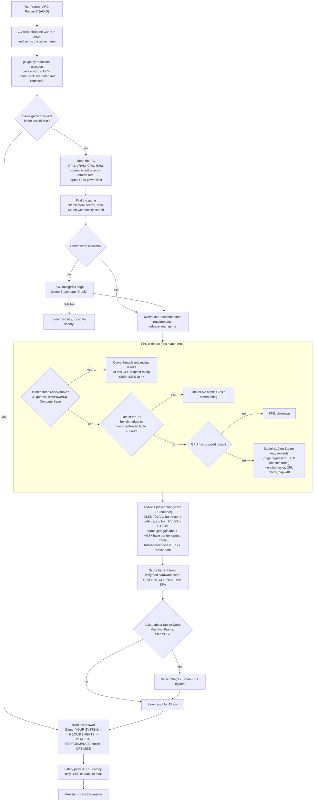
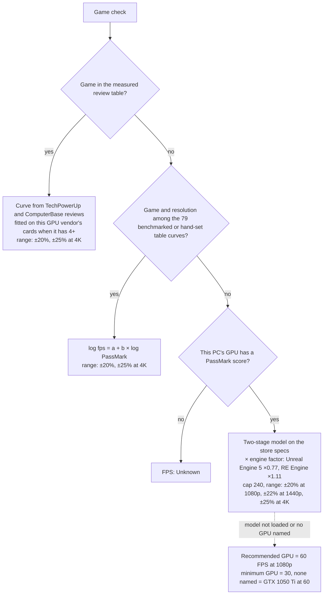

---
title: CanRun – tells you if your PC can run any game with an advanced **S-A-B-C-D-F tier system
emoji: 🎮
colorFrom: red
colorTo: gray
sdk: gradio
app_file: app.py
pinned: false
license: apache-2.0
tags:
  - mcp-server
  - hardvare-check
  - gradio
  - python
  - mathematics
  - llm-tools
---
<table> <tr> <td width="110" valign="middle">  </td> <td valign="middle"> <h1 style="display:inline-block; vertical-align:middle; margin:0; padding:0;">  CanRun - System Spec Game Compatibility Checker </h1> </td> </tr> </table>
  
  [](https://github.com/canrun/canrun)
  [](https://www.python.org/downloads/)
  [](LICENSE)
  [](https://www.nvidia.com/en-us/geforce/technologies/g-assist/)
  [](https://steamcommunity.com/dev)
  [](https://developer.nvidia.com/mcp)

[](https://mod.io/g/g-assist/m/canrun2#description)

## 🚀 Overview

**CanRun** is an RTX/GTX-exclusive G-Assist plugin that instantly tells you if your PC can run any game with an advanced **S-A-B-C-D-F tier system** and enhanced Steam integration.

AVAILABLE on official Nvidia g-assist mod marketplace:  [mod.io/canrun](https://mod.io/g/g-assist/m/canrun2#description). CanRun is trending and top rated on the [G-Assist hub](https://mod.io/g/g-assist). The next marketplace upload is **version 13.4.0**.

[](https://mod.io/g/g-assist/m/canrun2#description)

## Just ask

Press **Alt+G** in the NVIDIA App overlay and type **"canrun cyberpunk 2077?"**. A real 12.2 answer on an RTX 4090 with a 144 Hz screen, shortened:

```text
🎮 Game: Cyberpunk 2077

💻 YOUR SYSTEM
- GPU: RTX 4090 (24GB)
- CPU: AMD Ryzen 7 7800X3D 8-Core Processor
- Display: 3072x1728 @ 144Hz (FPS at 1440p)

🎯 VERDICT: ✅🏃 CAN RUN

⚡ PERFORMANCE
- FPS: 113-144 (similar PC, native, RT off)
- Faster screen: about 113-170 FPS
- DLSS 4.5: DLAA, Quality to Performance
- Frame gen 2x: +115 FPS (usually 1.8x)
- Path tracing: -70 to -95 FPS (2-3x heavier)
- Score: S Tier (97/100)

🕹️ STEAM DEVICES
- Steam Deck: Verified (30 FPS 800p, players)
- Steam Machine: Verified (74 FPS 1080p medium, estimate)
- Steam Frame: Playable
- Device FPS from SteamFPS (steamfps.com), CC BY 4.0

Estimate only. Your FPS may vary.
```

The range is about 20% either side of CanRun's estimate. On desktop GeForce cards, in games with review data, the real FPS landed inside it about 4 times out of 5 (see [Real-World Accuracy](#real-world-accuracy-on-independent-benchmarks)).

## Demo

https://github.com/user-attachments/assets/e011090b-a49a-4fdf-82b4-00e6075949dd


## ✨ Key Features

- **🎯 RTX/GTX Optimized**: Exclusively designed for RTX/GTX systems with G-Assist integration
- **🎮 CANRUN! Indicator**: Instant visual feedback when your system meets game requirements
 
- **⭐ S-A-B-C-D-F Tier System**: Advanced performance classification with weighted scoring
- 
- **🧠 AI-Powered Analysis**: G-Assist routes natural language to the plugin. The S-A-B-C-D-F tier still comes from local hardware scoring
- **📈 Frame Rates**: The number you see is an estimate built in steps. If the game is in CanRun's local benchmark table, the estimate is read off that game's curve. Otherwise the ML model predicts it from the live Steam store specs. That full estimate beats the model alone on independent benchmarks (see [Real-World Accuracy](#real-world-accuracy-on-independent-benchmarks)). No Steam player FPS data is used: Steam's frame-rate endpoint rejects outside Web API keys. The S-A-B-C-D-F tier still comes from local hardware scoring, not from that FPS number.
- **🔒 Local Matching**: GPU and CPU names stay on this PC. The frame-rate request sends only the Steam app id
- **🎯 Steam-First Data**: Game requirements come from the Steam store, with PCGamingWiki as a fallback when Steam refuses requests. DLSS and ray tracing notes follow NVIDIA's RTX games list. See [where the data comes from](#features)
- **🎯 Intelligent Game Matching**: Names are matched against Windows games from the last 30 days and the current 100 bestsellers, then the Steam store. A close or split title still lands on the published game.
- **📊 Smart Performance Prediction**: Comprehensive hardware hierarchies
- **💡 Intelligent Recommendations**: AI-generated optimization tips
- 
- **🤖 MCP Server**: Official Model Context Protocol (MCP) server for G-Assist integration
- **🔄 JSON-Based Configuration**: All benchmark data externalized for easy maintenance
- **🏃 Protocol V2 Plugin**: `plugin.py` on G-Assist SDK 3.1.0. Commands keep answering pings while a Steam lookup runs


## How a check works

From "canrun ARC Raiders?" to the answer in G-Assist:



1. **Question.** G-Assist sends the game name. Starting with "canrun" routes the question straight to the plugin. Words such as "on Steam Deck" switch on the Steam device section and are removed before the game search.
2. **Saved result.** A game checked in the last 15 minutes is answered from the saved result.
3. **The PC.** GPU (through NVML when available), VRAM, CPU and RAM. The screen is read in real pixels, so a 4K screen at 125% Windows scaling is 3840x2160 and the estimate is for 4K. On laptops the GPU power limit is read too, and a low limit adds a warning.
4. **The game.** Steam store search, then Steam Community search. The store page gives the minimum and recommended requirements, release year and genre. When Steam refuses, the game's PCGamingWiki page is used if it lists the same Steam app ID.
5. **FPS estimate.** Native resolution, ray tracing off. The first source with data wins:
   - **Review table:** 33 games with measured FPS from TechPowerUp and ComputerBase. The curve through those cards is read at this GPU's PassMark score, fitted on this GPU vendor's cards when the game has at least 4 of them. ARC Raiders comes from here: 79-132 FPS on an RTX 4090 at 4K, around ComputerBase's 102.8.
   - **The 79 trusted table curves:** 21 anchored to published benchmarks and 58 calibrated by hand. The 1,618 curves generated from the store-spec rule are skipped.
   - **The model:** model v1.0 estimates from the Steam requirements plus this GPU, VRAM and CPU, multiplied by the engine factor (Unreal Engine 5 ×0.77, RE Engine ×1.11), capped at 240.
   - **Unknown:** shown when the GPU has no PassMark score.
6. **Add-ons.** NVIDIA's RTX games list (downloaded weekly) decides which DLSS, DLAA, frame generation and path tracing lines appear. Frame generation shows the measured gain, for example "+85 FPS (usually 1.8x)" for 2×. FPS above the screen's refresh rate adds a "Faster screen" line. The FPS number stays the same.
7. **Score and verdict.** The S to F tier is a weighted hardware score (GPU 60%, CPU 25%, RAM 15%), separate from the FPS. The verdict is ✅🏃 CAN RUN or ❌ CANNOT RUN against the game's requirements.
8. **Steam devices (on request).** Valve's Steam Deck, Machine, Frame and SteamOS ratings, plus SteamFPS figures when SteamFPS has the game.
9. **Answer.** Your system, a divider, the requirements, a divider, then verdict, performance, "Estimate only. Your FPS may vary." and tips. A final pass keeps only ASCII and emoji, because G-Assist drops answers with other symbols, and caps the answer at 1,400 characters.

Hardware details stay on the PC. CanRun only downloads public data: the Steam store, PCGamingWiki, NVIDIA's RTX list and SteamFPS. Steam player FPS is not used, because Steam's frame-rate endpoint is closed to outside keys.


## Recent changes

**13.4.0** is the current release. Release notes live with the [G-Assist Hub release](https://mod.io/g/g-assist/m/canrun2#description). The FPS model is the same as in 12.2.0. In short:

- The display size is read in real pixels. With Windows display scaling, 12.2 read a 4K screen at 125% as 3072x1728 and estimated FPS for 1440p; it is now 3840x2160 and the estimate is for 4K.
- ARC Raiders joins the measured review table, from [ComputerBase's 2026 GPU suite](https://www.computerbase.de/artikel/grafikkarten/nvidia-geforce-amd-radeon-benchmark-test-2026.97097/seite-3) (Epic preset, native, ray tracing off, 15 cards at 1440p and 10 at 4K). Its RTX 4090 result at 4K, 102.8 FPS, matches about 105 FPS measured on the developer's PC.
- The 1,618 benchmark-table curves generated from the store-spec rule are no longer shown as a similar PC's FPS. Those games get the model's estimate directly. On OpenML the median error moves from 30.0% to 30.2% and the mean from 44.7% to 43.3%; TechSpot is unchanged at 13.3%.

- DLSS, frame generation, ray tracing and path tracing notes follow [NVIDIA's RTX games list](https://www.nvidia.com/en-us/geforce/news/nvidia-rtx-games-engines-apps/) (1,000+ games, public JSON, no key). A note appears only when the game ships that feature and the GPU can run it: frame generation on RTX 40 and 50, multi frame generation on RTX 50 at 3× to 4× for games NVIDIA lists with 4×, and 4× to 6× for games listed with 6×, path tracing only for games NVIDIA lists with it. Frame generation gains use measured results in place of the 2×/3×/4× labels: each generated frame adds about 0.8 of the base frame rate, so 2× gives about 1.8× (up to 2× when the CPU is the limit), 3× about 2.7× and 4× about 3.5× ([Tom's Hardware, Alan Wake 2 on RTX 4090, 5080 and 5090](https://www.tomshardware.com/pc-components/gpus/nvidia-dlss4-mfg-and-full-ray-tracing-tested-on-rtx-5090-and-rtx-5080)). 6× uses the same rate and is an estimate. On an RTX 4090 in ARC Raiders, DLAA went from about 90 FPS to about 160 FPS with 2× frame generation (1.78×). Games missing from the list get no DLSS notes. The list is downloaded on the user's PC and kept for a week; if it cannot be read, the earlier general notes are shown.
- The Steam device section appears when the question names a Steam Deck, Steam Machine, Steam Frame or SteamOS ("canrun ARC Raiders on Steam Deck?"). Other answers end with the score and verdict.
- When the Steam store refuses requests (HTTP 403 or 429, or a server error), requirements come from the game's [PCGamingWiki](https://www.pcgamingwiki.com) page instead, used only when the page lists the same Steam app ID. If that fails too, the answer says the Steam store is not answering and asks you to try again, instead of saying the game is not on Steam. The Steam Community search fallback now sends the title in the URL path; the old query form always returned an empty list.
- Questions are read more loosely: "Can I run X on my PC?", "How will X run?", "What FPS will I get in X?" and "X on Steam Deck" all find the game. The manifest asks G-Assist to pass every game name to CanRun, including new releases its own model does not know, such as ARC Raiders.

**12.2.0:**

- The model now gets the game's full store specs (recommended CPU and RAM, release year, genre) and your GPU's VRAM, not only the recommended GPU. On the TechPowerUp store-spec test this moved the error from 20.8% to 18.7%.
- Benchmark curves are fitted on your GPU vendor's cards when the game has at least 4 of them. Mixed AMD and NVIDIA curves read about 8% high for NVIDIA.
- A measured review table (`data/measured_benchmarks.json`, 32 games from TechPowerUp reviews) is checked before the older benchmark table, and the 12.2.0 zip ships it.
- Laptop GPUs (RTX 3050 to 5090 Laptop) and the RTX Spark N1X are recognized with their own PassMark scores. 12.1 read a laptop GPU as the faster desktop card and was 39% too high on average on Notebookcheck's laptop results (23.0% median error); without the measured table 12.2 is 22.0% off with a −2% bias, and 14.9% with it. Every GPU lookup now prefers the longest matching name, so "RTX 4060 Ti" is never read as "RTX 4060".
- Games without a measured curve get an engine correction. `data/game_engines.json` maps 7,916 Steam games to their engine (from Wikidata, CC0), and engines with at least 3 measured games get a factor: Unreal Engine 5 ×0.77, RE Engine ×1.11. Holding out each of 30 measured games, the store-spec error drops from 25.0% to 23.1% median (33.2% to 28.3% average). Rebuild with `real_benchmarks.py fetch-engines` and `engine-factors`.
- Answers can list Valve's own compatibility rating for the Steam Deck, Steam Machine, Steam Frame and SteamOS (Verified, Playable or Unsupported), read live from the Steam store without an API key, and says when a game needs a VR headset. Devices Valve has not rated are left out. When [SteamFPS](https://steamfps.com/api) has the game, the Steam Deck and Steam Machine lines add its FPS figure, labeled as an estimate, player reports or measured as SteamFPS marks it, with the attribution its CC BY 4.0 licence asks for. SteamFPS lookups are cached for a day, and the section is dropped when the answer would be cut off.
- On NVIDIA laptops the GPU power limit is read through NVML. When a laptop runs its GPU below 70% of the most power NVIDIA allows for that model, the answer says FPS can be lower than shown. The FPS number itself is not changed, because there is no test data yet that pairs laptop power limits with measured FPS.
- A longer typed title only matches a shorter benchmark title when the extra words are edition words, so "Prince of Persia The Lost Crown" no longer uses the "Prince of Persia" curve.
- Benchmark tables are cached until the file changes, and the "FPS Unknown" message names the real cause.

**12.1.0:** titles match on whole words, more GeForce cards are recognized, and the full estimate (not the model alone) is 15.2% off end to end on independent benchmarks.

**12.2.0 against earlier versions** (median error on outside benchmarks, lower is better):

| Test | v8 | 12.1 | 12.2 |
| :--- | :---: | :---: | :---: |
| TechSpot desktops, all cards (98 points) | 75.1% | 32.9% | **13.3%** |
| TechSpot desktops, NVIDIA (55) | 63.8% | 28.6% | **10.0%** |
| Notebookcheck laptops (about 1,100 to 1,300) | not run | 23.0% (+39% bias) | **14.9%** |
| TechPowerUp RTX 5070 review, end to end (308) | n/a | 15.2% | **9.3%** |
| TechPowerUp 2025, games without a curve (266) | 79.8% | 20.8% | **18.7%** |
| OpenML user reports, older games (11,842) | 39.8% | 30.7% | **30.0%** |
| Unmeasured games, each held out (30 games, NVIDIA) | n/a | not run | **23.1%** (25.0% without the engine correction) |

The 12.2 end-to-end row was scored with the earlier 25-game table.

The model card is [grasant/canrun-fps-predictor](https://huggingface.co/grasant/canrun-fps-predictor) v1.0.

## 📦 G-Assist Plugin Installation

### **Build the marketplace zip (main way)**

This is the main way to build the plugin for the [G-Assist Hub on mod.io](https://mod.io/g/g-assist/m/canrun2#description). It produces the thin official layout: `plugin.py`, `manifest.json`, `config.json`, `requirements.txt`, the JSON tables under `data/`, and `libs/` (SDK plus the packages the plugin actually imports). Training pickles and unused pip packages are left out.

```bash
cd canrun
pack_g_assist_zip.bat
```

The zip is `dist/canrun-<version>.zip` (currently `dist/canrun-13.4.0.zip`). Upload that file to mod.io.

To build the standalone `dist/g-assist-plugin-canrun.exe` instead, use the project venv, which has the GPU detection packages:

```bash
.venv\Scripts\python.exe -m PyInstaller g-assist-plugin-canrun.spec --noconfirm --clean
```

The archive has a single `canrun-<version>/` root folder. mod.io installs that folder by name, version included, and G-Assist launches the plugin under that same name. After installing or updating, restart G-Assist from the NVIDIA overlay (IGO).

CanRun follows the current [NVIDIA G-Assist](https://github.com/NVIDIA/G-Assist) plugin contract: Protocol V2, JSON-RPC 2.0, and `gassist_sdk` 3.1.0. G-Assist launches `plugin.py` directly. The SDK is vendored at `libs/gassist_sdk`. The engine adds `libs/` to `PYTHONPATH`. `plugin.py` also adds the plugin directory to `sys.path`, because modules next to it are not on that path.

```
plugins/
└── canrun/                          # Plugin directory name = invocation name
    ├── plugin.py                    # Protocol V2 entry point
    ├── manifest.json                # protocol_version 2.0
    ├── config.json                  # Settings
    ├── requirements.txt             # Runtime packages installed into libs/
    ├── data/                        # Benchmark data
    └── libs/
        └── gassist_sdk/             # Vendored SDK 3.1.0
```

Install location:

```
%PROGRAMDATA%\NVIDIA Corporation\nvtopps\rise\plugins\canrun
```

### **🚀 AUTOMATIC INSTALLATION (RECOMMENDED)**

**Run the installation script as Administrator:**

```bash
cd canrun
install_g_assist_plugin.bat
```

The installer will:
- Copy the plugin sources, manifest, data, and vendored SDK
- Install `requirements.txt` into `libs/`
- Verify `plugin.py`, `manifest.json`, and `libs/gassist_sdk`

**Requirements:**
- Administrator privileges (required to write under `%PROGRAMDATA%`)
- Python 3.12+ on PATH
- NVIDIA G-Assist installed

### **📋 MANUAL INSTALLATION (ALTERNATIVE)**

**Step 1: Create the plugin directory**

```
mkdir "%PROGRAMDATA%\NVIDIA Corporation\nvtopps\rise\plugins\canrun"
```

**Step 2: Copy Plugin Files**

```bash
xcopy /E /I "canrun" "%PROGRAMDATA%\NVIDIA Corporation\nvtopps\rise\plugins\canrun"
pip install -r "%PROGRAMDATA%\NVIDIA Corporation\nvtopps\rise\plugins\canrun\requirements.txt" -t "%PROGRAMDATA%\NVIDIA Corporation\nvtopps\rise\plugins\canrun\libs"
```

**Step 3: Restart G-Assist**
1. Close NVIDIA App / G-Assist completely
2. Restart NVIDIA App
3. Enable G-Assist if it is not already enabled

**Step 4: Test Plugin**
Try these commands:
- "can I run elden ring"
- "canrun cyberpunk 2077"

### **Plugin Architecture Notes**
- **Directory Name**: Must match the plugin invocation name (`canrun`)
- **Executable**: `plugin.py` (`manifest.json` field `executable`)
- **Protocol**: `protocol_version` `"2.0"`. Messages are JSON-RPC 2.0 with a 4-byte big-endian length prefix
- **Persistent**: `true`, so the engine can ping the plugin while a Steam lookup runs
- **CLI Mode**: `python plugin.py canrun "cyberpunk 2077" --json`

### **🔧 Troubleshooting**

If the plugin is not detected by G-Assist:

1. **Verify Installation Path**: Run the installation script again
2. **Check File Permissions**: Confirm `plugin.py`, `manifest.json`, and `libs/gassist_sdk` were copied
3. **Restart G-Assist**: Completely close and restart NVIDIA App/G-Assist
4. **Check Logs**: Review `%USERPROFILE%\canrun_plugin.log` and `gassist_sdk.log` in the plugin directory
5. **Test CLI Mode**: Run `python plugin.py canrun "cyberpunk 2077" --json` from the plugin directory

A benchmark-curve FPS line looks like `FPS: 93-139 (similar PC, native, RT off)`. A heavier monitor adds `FPS at 1440p` on the display line. When the benchmark table does not have the game, the ML model estimates FPS from the store specs, for example `FPS: 53-83 (from recommended GPU, RT off)`. Every answer line is kept short enough to fit on one line in the G-Assist panel, so requirement hardware drops brand words (`RTX 2070 / RX 5700 XT / Arc B570`).

### Keyless Runtime & Developer `.env` Setup

End users do **not** need a Steam Web API key. `config.json` ships completely keyless: CanRun fetches game requirements directly from the public Steam Store API and runs local FPS inference using the bundled benchmark curves and pre-compiled Two-Stage Log-Ridge + Monotonic GBDT model (`data/ml_fps_model_unified.json`).

For developers running the offline Steam API data-collection pipeline (`scripts/ds_pipeline/collect_and_audit.py`), copy `.env.example` to `.env` and add your developer key:

```bash
cp .env.example .env
# Edit .env and set STEAM_WEBAPI_KEY=your-key-here
```

Both `.env` and `data/` are listed in `.gitignore` so API keys and harvested Steam dataset files are never committed to git or bundled into the release zip (`pack_g_assist_zip.bat`).

## Installation and Setup

### Prerequisites
- Python 3.12+ (NVIDIA G-Assist requirement)
- Windows 10/11 (for hardware detection)
- NVIDIA GPU recommended for full G-Assist integration
- **uv package manager** for the development install below

### Install uv Package Manager
If you don't have `uv` installed:
```bash
# Install uv package manager
pip install uv
```

### Option 1: G-Assist plugin (Protocol V2)

```bash
# Clone repository
git clone https://github.com/leksval/canrun
cd canrun

# Install the plugin for G-Assist (Administrator)
install_g_assist_plugin.bat

# Protocol check and CLI
uv run python -m pytest test/test_official_g_assist_protocol.py -v
uv run python plugin.py initialize --json
uv run python plugin.py canrun "cyberpunk 2077" --json
```


### Option 2: Full ML Pipeline Development

```bash
# Clone repository
git clone https://github.com/leksval/canrun
cd canrun

# Install full development environment with ML training capabilities using pyproject
uv sync --all-extras

# Run comprehensive test suite
uv run pytest test/ -v

# Train unified stacking ensemble ML model
uv run python src/train_unified_ml_model.py

# Test plugin functionality
uv run python plugin.py canrun "cyberpunk 2077" --json
```

### G-Assist MCP Integration

G-Assist can automatically discover and use the CanRun MCP server when both are running. This enables advanced conversational interactions like:

- "G-Assist, ask CanRun if I can play Starfield"
- "G-Assist, check if my system meets Diablo 4 requirements"
- "G-Assist, what's my gaming hardware like?"

## 🧪 Running Tests

**Primary Test Command (Recommended):**

```bash
# Navigate to canrun directory first
cd canrun

# Run all tests with pytest using uv
uv run python -m pytest test/ -v

# Protocol V2, Steam FPS cases, and security edge cases
uv run python -m pytest test/test_official_g_assist_protocol.py test/test_steam_fps_cases.py test/test_edge_cases.py -v
```

## 🤖 MCP Server Functionality

CanRun now includes a full-featured **Model Context Protocol (MCP) server** that allows G-Assist to directly integrate with the CanRun compatibility engine. This provides seamless AI-assisted game compatibility checking through the official NVIDIA MCP standard.

### MCP Tools and Capabilities

The MCP server exposes the following tools to G-Assist:

- **check_game_compatibility**: Analyze if a specific game can run on the current system
  - Input: Game name (e.g., "Cyberpunk 2077")
  - Output: Detailed compatibility analysis with performance tier

- **detect_hardware**: Provides comprehensive hardware detection for gaming systems
  - Output: Detailed hardware specifications focused on gaming performance

### Running the MCP Server

```bash
# Start the local UI. It binds to 127.0.0.1 only.
python app.py
```


## 🧠 ML Pipeline

CanRun v13.4 ships the **v9.0 Two-Stage Log-Space Physics Ridge Prior + Monotonic Residual GBDT + Empirical Bayes Shrinkage** architecture (`data/ml_fps_model_unified.json`). At runtime, the compiled model is evaluated in **100% pure Python** (`canrun_model_loader.py` and `canrun_steam_fps.py`) with zero `scikit-learn`, `xgboost`, or `pickle` runtime dependencies.

### **Why We Changed the Model (Legacy v8.0 vs. New v9.0 / v1.0 Production Release) & By How Much It Improved**

#### **The first model (v8.0): what it was and why it was built that way**

v8.0 (`Unified_Stacking_Ensemble_2025`, version `8.0_2025_Edition`) was a real machine-learning model. Its pickles are still in `data/`: `unified_stacking_model.pkl`, `unified_scaler.pkl` and `unified_calibrator.pkl`.

- **Architecture:** a scikit-learn `StackingRegressor` with seven base models: XGBoost (trained on CUDA), LightGBM, CatBoost, random forest, gradient boosting (300 trees, depth 12), extra trees (300 trees) and ridge regression. A Bayesian ridge meta-learner combined them. An isotonic calibrator and a fixed ×0.88 correction came after it.
- **Inputs:** 75 features after a `RobustScaler`. These were GPU PassMark, VRAM, GPU generation and architecture flags, resolution, 15 one-hot `game_*` columns (one per training game), engine one-hots, and a complexity and ray-tracing score taken from keywords in the game description. It never used the Steam minimum or recommended requirements.
- **Data:** 179 rows from 15 games, split randomly into 143 for training and 36 for testing. The saved test scores were R² 0.984 for the stack, 0.994 after calibration and 0.956 after the ×0.88 correction.
- **Shipping:** the plugin read a 675-entry lookup table (15 GPUs × 15 games × 3 resolutions) of FPS values that the ensemble had produced. For other games it fell back to the "General Gaming" entries, then to a heuristic.

**Why it was built that way.** The only trustworthy data at the time was about 180 measured points across 15 popular games. With that little data, a stacking ensemble of strong tabular learners is the standard way to squeeze out the most accuracy, and a game one-hot lets each game have its own baseline. Precomputing a lookup table kept the plugin fast and avoided loading the pickles in G-Assist.

**Pros of v8.0**
- A strong, well-known ensemble that fit its 15 games closely.
- It needed no store requirements, so a game whose Steam page lists outdated specs did not mislead it.
- The lookup table made the shipped plugin instant.

**Cons of v8.0**
- It could not tell new games apart. Any game outside the 15 got all-zero game columns and a description-keyword guess, so the model only knew it was "some game".
- It overestimated badly on new games (+90% to +110% bias on the independent tests below). An RTX 5090 in Cyberpunk 2077 at 1080p came out at 369.6 FPS.
- 179 rows is very little data for 75 features and seven models, and a random split put rows from the same game in both training and test, so the 0.984 score mostly measured memorization of those 15 games.
- About 20–30 ms per prediction when the ensemble runs, with pickles plus scikit-learn, XGBoost, LightGBM and CatBoost as dependencies, and Python version risk on load.
- Bugs in the feature code: `vram_usage_encoded` was always 2, CPU cores and base clock were filled with the defaults 3000 and 1500 in training, and the architecture-efficiency feature divides by zero for GPUs released in 2014.

#### **v8.0 and v1.0 on the same independent benchmarks**

To compare the two models directly, `scripts/ds_pipeline/evaluate_legacy_v8.py` loads v8.0's own pickles, rebuilds its 75 features with its training-time code and data files (from git revision `5a61ba3^`), and runs the ensemble itself, not the lookup table. The rebuild reproduces 635 of v8's 675 saved FPS values within 0.1 FPS, and the rest within 4.7 FPS. It then runs the three independent benchmark scripts with v8 in place of the current model. This compares the model alone. The full app adds the benchmark-table step on top of either model.

| Test (median error, model alone) | v8.0 ensemble | v1.0 model | Simple spec rule |
|---|---|---|---|
| TechPowerUp, 266 points, new games | 79.8% (bias +108.5%, 4.5% within 10%) | **18.9%** (bias −13.9%, 31.2% within 10%) | 19.8% |
| TechSpot, 98 points | 75.1% (bias +91%) | **36.7%** (bias −34.6%) | 37.5% |
| TechSpot, NVIDIA cards only (55 points) | 63.8% | **33.6%** | 35.8% |
| TechSpot, AMD and Intel cards | 89.0% | 40.7% | **39.1%** |
| OpenML user reports, 11,842 points, older popular games | 39.8% (bias +14.4%, 14.4% within 10%) | 38.8% (bias −7.0%, 10.0% within 10%) | **36.7%** (bias +5.2%, 11.1% within 10%) |

On new games, v1.0 cuts the median error by about three quarters, from 75–80% to 19–37%. v8 missed Silent Hill 2 by +235%, Star Wars Outlaws by +192% and Dragon Age by +145%. On OpenML's older games the two are roughly tied. v8 wins on Dota 2 (39.8% vs 52.2%), GTA V (44.5% vs 66.7%) and Rust (44.7% vs 52.1%). v1.0 wins on Apex Legends (28.2% vs 39.5%) and PUBG (26.1% vs 34.7%). v8 also does better on CS:GO and Overwatch (32.6% vs 56.6%), where OpenML measured an older version than the one Steam lists now. Since v8 ignores store specs, outdated specs can't mislead it.

**Why v1.0 is better**
- **It reads the game's Steam requirements.** The minimum and recommended GPUs tell it how demanding a game is, so a new game is not just "some game". This is the main reason for the gap on TechPowerUp and TechSpot.
- **No game identifiers.** The model has no per-game columns, so it can't memorize titles and has nothing missing for new ones.
- **Monotonic.** A faster GPU never gets fewer FPS for the same game and resolution, and a higher resolution never gets more.
- **Much more training data**, though most of it is generated. See [Training Data Description](#training-data-description-636225-records-across-1697-steam-games).
- **About 400× faster** (0.06 ms vs 20–30 ms) and stored as plain JSON, with no pickles or ML libraries at runtime.

#### **v1.0 model vs the simple spec rule**

The simple rule is `60 × (your GPU PassMark ÷ recommended GPU PassMark)^0.85`, multiplied by 0.75 at 1440p. Most of v1.0's training curves were generated from rules like this one (only 79 of the 1,697 games carry outside measurements), so on the median the two are close. The model is better in these specific ways:

- **It reads more of the store page.** The rule sees only the recommended GPU and the resolution. In the benchmark tests the model also gets the minimum GPU, the recommended CPU against your CPU, recommended VRAM against your card's VRAM, recommended RAM, the release year and the genre. It learned from the 79 measured and hand-calibrated games how much each of these matters. F1 24 shows the difference: the model is 29.2% off and the rule 54.4% off.
- **Fewer large misses.** The median hides this; the mean and the FPS error show it. On TechPowerUp the mean error is 18.8% against 23.1%, the average miss 26.5 FPS against 34.4 FPS, and R² 0.503 against 0.064, so the rule barely tracks which card-and-game pairs run faster. On OpenML the rule has the better median, but the model has the lower mean error (43.1% vs 47.7%), the lower average miss (40.5 vs 42.5 FPS) and a higher R² (−0.67 vs −0.94). The rule's worst game there is GTA V at 101.2% off; the model is 66.7% off.
- **More results close to the measured FPS.** On TechPowerUp, 31.2% of the model's predictions are within 10% (rule: 25.2%) and 59.0% within 22% (rule: 55.3%). Its bias is smaller, −13.9% against −19.0%.
- **Better on NVIDIA cards and on games where the curve shape matters.** TechSpot NVIDIA cards: 33.6% against 35.8%. Silent Hill 2: 8.3% against 11.1%. Star Wars Outlaws: 8.2% against 11.3%.
- **It gives a range and stays monotonic.** The rule gives one number. The model also gives an uncertainty band, and its constraints guarantee more FPS for a faster GPU, fewer at a higher resolution, and more VRAM headroom never hurting.

The app passes all of these to the model: your GPU's VRAM, the recommended CPU and RAM parsed from the store page, and Steam's release year and genres. Before that change it passed only the two GPU scores, and its store-spec path scored 20.8% median error on the 7 TechPowerUp games (33.8 FPS average miss, R² 0.08). With the full specs it scores 18.7% (26.5 FPS, R² 0.50), the same as the model given everything.

**Where it is not better.** v1.0 only slightly beats the simple spec rule it was built on (18.9% vs 19.8% on TechPowerUp, 36.7% vs 37.5% on TechSpot). The rule beats it on AMD and Intel cards (39.1% vs 40.7%) and on OpenML (36.7% vs 38.8%). It is no better than v8 on older popular games, and outdated store specs hurt it. Most of the accuracy users see comes from the benchmark table, which works the same with either model.

The `M1`/"Old v8.0" scores in the cross-validation tables below were computed differently. They simulate the v8 plugin's lookup table with its "General Gaming" and heuristic fallbacks on CanRun's own benchmark suite. The ensemble itself is not run there.

#### **Can We Hit +98% Without Hurting Generalization?**
**Yes on the scores that matter for a shipped plugin. No on raw-FPS Leave-Games-Out $R^2$, unless we cheat.**

All scores in this table are cross-validation on CanRun's own benchmark suite, whose curves share one collection pipeline. They do not carry over to outside data, where the median error is 15–30%. See [Real-World Accuracy](#real-world-accuracy-on-independent-benchmarks).

| What “+98%” usually means | New v9.0 score | Already ≥ 98%? | Safe to push higher? |
| :--- | :---: | :---: | :--- |
| **Unseen-GPU $R^2$** (known game, new graphics card) | **`0.9987` (`99.87%`)** | **Yes** | Already there. Empirical Bayes on the game's curve does this. |
| **Median accuracy** (`100 − MdAPE`) on unseen games | **`98.81%`** (`1.19%` MdAPE) | **Yes** | This is the typical-title score a user actually feels. |
| **Log-space $R^2$** on unseen games (the loss we train on) | **`0.9692` (`96.92%`)** | Almost | Leak-free regime features (`is_capped_60`, `genre_demand`, `cpu_headroom_rec`) can still inch this toward `0.98`. |
| **Raw-FPS $R^2$** on unseen games | **`0.9589` (`95.89%`)** | No | The remaining `~4%` is high-FPS esports tails + engine-lock outliers. Forcing `0.98` here means adding `game_name` / AppID features or using random $k$-fold — the leak that let v8.0 score $R^2 = 0.984$ on a random split of its 15 games, while its shipped lookup table scored **`0.0932`** on unseen games. |
| **Mean accuracy** (`100 − MAPE`) on unseen games | **`95.52%`** (`4.48%` MAPE) | No | A `2%` MAPE (`98%` mean accuracy) is far below the 12.5% spread between user reports on identical hardware in OpenML. Claiming it would overfit our synthesizer, not real hardware. |

**What we refuse to do to fake 98% raw $R^2$:** one-hot / target-encoded `game_name`, `steam_app_id`, or `gpu_model`; random (non-grouped) $k$-fold; reporting in-sample $R^2$ instead of Leave-Games-Out.

**What we did instead (leak-free):** added 3 regime features that exist at inference from the Steam store page or title text — `is_capped_60` (60 FPS engine lock), `genre_demand`, `cpu_headroom_rec`. That lifted unseen-game raw $R^2$ from `0.9539` → **`0.9589`** and MAPE from `4.57%` → **`4.48%`**, with monotonicity still at **`0.01%`**.

#### **Executive Summary: How Much Better Is the New Model?**
Evaluated across **`636,225` hardware-game-resolution records** (`1,697` Steam games $\times$ `25` GPUs $\times$ `3` resolutions $\times$ `5` CPU tiers — **`942.6×` larger** than legacy v8.0's `675` lookup entries) under strict **5-Fold `GroupKFold` Cross-Validation**:

- **On Unseen Games (`Leave-Games-Out CV` — Cold-Start Generalization to Brand-New Titles):**
  - **$R^2$ (raw FPS):** Improved from **`0.0932`** (Old v8.0) and **`0.7270`** (Naive Spec Heuristic) to **`0.9589`** (**`+0.8657` $R^2$ gain / `10.3×` higher explained variance**).
  - **$R^2_{\log}$ (trained loss):** **`0.9692`** vs. **`0.6409`** in Old v8.0.
  - **MAPE:** Reduced from **`30.38%`** (Old v8.0) and **`12.80%`** (Heuristic) to **`4.48%`** (**`6.78×` lower error / `-85.3%` relative error reduction** vs. Old v8.0).
  - **MdAPE:** Reduced from **`15.23%`** (Old v8.0) to **`1.19%`** (**`12.8×` lower median percentage error** — **`98.81%` median accuracy**).
  - **MAE:** Reduced from **`30.85 FPS`** (Old v8.0) to **`3.97 FPS`** (**`7.77×` lower FPS error**).
  - **RMSE:** Reduced from **`52.90 FPS`** (Old v8.0) to **`11.27 FPS`** (**`4.69×` lower tail error**).
  - **Physical Monotonicity Violations:** Reduced from **`11.17%`** (Old v8.0) to **`0.01%`**.
- **On Unseen GPUs (`Leave-GPUs-Out CV` — Hardware Generalization to New Graphics Cards):**
  - **$R^2$:** Improved from **`0.0949`** (Old v8.0) to **`0.9987`** (`99.87%`).
  - **MAPE:** Reduced from **`30.35%`** (Old v8.0) to **`1.08%`** (`0.55%` MdAPE — **`28.1×` lower percentage error**).
  - **MAE:** Reduced from **`30.79 FPS`** (Old v8.0) to **`0.90 FPS`**.
  - **Physical Monotonicity Violations:** Reduced from **`11.16%`** (Old v8.0) to **`0.00%`**.

#### **4 Core Architectural Reasons Why the New Model Wins**
1. **Eliminated Target Leakage & Game-ID Memorization:**
   - **Problem in Old v8.0:** The legacy v8.0 ensemble had one-hot `game_*` columns for its 15 training games, and the plugin shipped a 675-entry lookup table built from it. A random train/test split on those 15 games reported $R^2 = 0.984$. **5-Fold `GroupKFold` by `game_name` (Leave-Games-Out)** on the lookup table and its fallbacks gave $R^2 = 0.0932$, $\text{MAPE} = 30.38\%$, $\text{MAE} = 30.85\text{ FPS}$ on unseen games.
   - **Benefit in New v9.0:** Zero game names, AppIDs, or GPU strings are fed into the regressor. Instead, v9.0 learns from **21 continuous physical & hardware-headroom ratios** (user GPU/CPU PassMark vs. official Steam minimum/recommended specs, pixel count ratio, VRAM/RAM headroom, and GPU architecture tier), achieving **$R^2 = 0.9589$** and **`4.48%` MAPE** on unseen games in the training suite.
2. **Enforced Physical Monotonicity Invariants:**
   - **Problem in Old v8.0:** Unconstrained trees and corrupted benchmark rows caused **`11.17%` monotonicity violations**, occasionally predicting lower FPS for a faster GPU on the same game and resolution.
   - **Benefit in New v9.0:** Stage-2 EDA gates repair cross-game duplicate rows and PassMark inversions prior to training, and Stage-4 enforces directional monotonic constraints (`+1` on hardware PassMark/VRAM/headroom, `-1` on resolution pixels), reducing monotonicity violations to **`0.00%`** on both unseen GPUs and unseen games.
3. **100% Keyless End-User Runtime & Zero Binary ML Dependencies:**
   - **Problem in Old v8.0:** Relying on live authenticated telemetry at runtime required users to obtain and paste a `steam_webapi_key`, while shipping `scikit-learn`/`joblib` `.pkl` files bloated the plugin and risked Python ABI mismatches.
   - **Benefit in New v9.0:** Both the Level-0 Ridge weights and Level-1 GBDT decision trees are compiled into pure JSON (`data/ml_fps_model_unified.json`) and traversed in `<1 ms` using standard-library Python. End users need **no API key** in `config.json`.
4. **Calibrated Split-Conformal Prediction Intervals:**
   - **Benefit in New v9.0:** Prediction ranges (`fps_min` to `fps_max`) are calibrated using out-of-fold log-residual quantiles per resolution (`1080p`, `1440p`, `4K`) to give $\mathbf{80.0\%}$ empirical coverage on held-out games and GPUs inside the benchmark suite (compared to only `20.89%` coverage in Old v8.0). On independent benchmarks the band is far too narrow: it held the measured FPS only 15.4% of the time on TechPowerUp. The plugin shows its own wider range instead.

### **Training Data Description (`636,225` Records Across `1,697` Steam Games)**

The training dataset (`data/clean_training_dataset.json`, kept local via `.gitignore` to respect Steam data copyrights) is a structured 4-dimensional panel dataset spanning **`Game × GPU × Resolution × CPU`**.

**Most of it is generated, not measured.** Every game gets a curve `FPS = anchor_4090 × (PassMark / 38,192)^β` over 25 GPUs and 3 resolutions. The anchor and exponent come from published benchmarks for 21 games, are set by hand for 58, and follow a fixed rule on the store's recommended GPU for the other 1,618, of which 990 use placeholder specs picked by release year. The curves are then expanded over 5 CPU tiers. Because the targets for about 95% of games are a function of the model's own inputs, the cross-validation scores in this section mostly show that the model learned that rule. Real-world error is 15–40% (see [Real-World Accuracy](#real-world-accuracy-on-independent-benchmarks)).

#### **1. Multi-Endpoint Steam API & Benchmark Data Sources (10 Sources)**
Using the developer `.env` `STEAM_WEBAPI_KEY` alongside public Steam Store and SteamSpy APIs, `scripts/ds_pipeline/collect_and_audit.py` queries **10 endpoints**. Nine return data. These endpoints supply game discovery, metadata and store specs, not frame rates:

| Data Source / Endpoint | Auth Required | Harvested Data & Role in Pipeline |
| :--- | :---: | :--- |
| **`ISteamChartsService/GetMostPlayedGames/v1/`** | `.env` `STEAM_WEBAPI_KEY` | Top **100** most-played Steam games by weekly active player rank |
| **`ISteamChartsService/GetGamesByConcurrentPlayers/v1/`** | `.env` `STEAM_WEBAPI_KEY` | Top **100** live concurrent-player Steam games |
| **`ISteamChartsService/GetTopReleasesPages/v1/`** | `.env` `STEAM_WEBAPI_KEY` | **88** top monthly Steam game releases |
| **`IStoreService/GetAppList/v1/`** | `.env` `STEAM_WEBAPI_KEY` | **1,000** active Windows PC game AppIDs from the Steam catalog |
| **`IStoreBrowseService/GetItems/v1/`** | `.env` `STEAM_WEBAPI_KEY` | **798+** bulk store metadata records (release timestamps, Steam Deck / Steam Machine / SteamOS hardware compatibility categories, VR support flags, store tags) |
| **`IGamePerformanceStatsService/GetGameFrameRateStats/v1/`** | Not available | **Returns nothing.** Player frame rates per hardware cluster. It is not in Valve's [Web API reference](https://partner.steamgames.com/doc/webapi) and returns HTTP 401 with a valid key, a fake key or no key (checked October 2026). The training set holds `0` Steam FPS reports. |
| **`store.steampowered.com/api/appdetails`** | Public Steam Store API | **700** full HTML PC requirement blocks (`pc_requirements.minimum` & `pc_requirements.recommended`) parsed into structured GPU, CPU, RAM, and VRAM specs |
| **`store.steampowered.com/api/featuredcategories`** | Public Steam Store API | Featured `top_sellers`, `new_releases`, `specials`, and `coming_soon` PC titles |
| **`store.steampowered.com/search/results/`** | Public Steam Store API | **500** paginated global top-seller PC game AppIDs (`category1=998`) |
| **`steamspy.com/api.php`** (`top100forever`, `top100owned`, `top100in2weeks`) | Public API | **100** top all-time owned & active Steam games with CCU and play-time metadata |

#### **2. All-Time Steam Bestsellers & 6 Weird Edge-Case Archetypes (`81` Curated Suites + `1,616` Live Steam API Games)**
Rather than padding the dataset with redundant generic games, the benchmark catalog specifically targets **All-Time Steam Bestsellers** and **6 extreme PC hardware/engine edge-case regimes** where naive power-law scaling fails:
1. **Hard 60 FPS Engine Physics Locks & Fighting/FromSoftware Engines:** *Elden Ring*, *Sekiro: Shadows Die Twice*, *DARK SOULS III*, *Street Fighter 6*, *TEKKEN 8* — teaches tied-leader ceiling detection (`_cap_at_tied_leaders()`) and low-resolution saturation without corrupting 4K budget-GPU scaling.
2. **Mandatory Hardware Ray Tracing & Severe VRAM Cliffs:** *Indiana Jones and the Great Circle*, *DOOM: The Dark Ages*, *Portal with RTX*, *Alan Wake 2*, *Black Myth: Wukong*, *Cyberpunk 2077* — trains the `vram_cliff_penalty` interaction feature for cards with `<8 GB–10 GB` VRAM at `1440p`/`4K`.
3. **Extreme CPU / Main-Thread Simulation Bottlenecks:** *Microsoft Flight Simulator*, *Cities: Skylines II*, *Factorio*, *Stellaris*, *Dragon's Dogma 2*, *Baldur's Gate 3*, *Escape from Tarkov*, *Star Citizen* — trains `cpu_bottleneck_1080p` across the 5 CPU tiers.
4. **Heavy Unreal Engine 5 (Lumen + Nanite) Open-World Titles:** *ARK: Survival Ascended*, *S.T.A.L.K.E.R. 2: Heart of Chornobyl*, *Black Myth: Wukong*, *The Blood of Dawnwalker* — models `32 GB` RAM demand and sub-95 FPS flagship 4090 native anchors.
5. **High-Refresh Esports & 2D Indie Engine Caps:** *Counter-Strike 2*, *Valorant*, *Overwatch 2*, *Apex Legends*, *Rainbow Six Siege*, *Hollow Knight*, *Hades II*, *Terraria*, *Stardew Valley* — models diminishing returns ($\beta_{1080\text{p}} \in [0.10, 0.58]$) and `240–360 FPS` engine caps.
6. **All-Time Steam Bestsellers & Evergreen Classics:** *Grand Theft Auto V*, *The Elder Scrolls V: Skyrim Special Edition*, *Red Dead Redemption 2*, *The Witcher 3: Wild Hunt*, *Monster Hunter: World*, *Fallout 4*, *Garry's Mod*, *Left 4 Dead 2*, *The Sims 4*, *Phasmophobia*, *Lethal Company*, *No Man's Sky*, *Dead by Daylight*, *EA SPORTS FC 25*.

#### **3. Panel Structure & Hardware / Resolution Dimensions**
Each of the **1,697 unique Steam games** (**1,616 live Steam API games** + **81** curated multi-resolution benchmark suites, up from **15 games** in legacy v8.0 — **`113.1×` more games**) is evaluated across:
- **25 Standardized GPUs (`data/gpu_hierarchy.json`)** spanning 7 architecture generations from `7,875` to `39,876` PassMark G3D score and `4 GB` to `32 GB` VRAM:
  - **NVIDIA Blackwell (`RTX_50`)**: `RTX 5090` (32 GB), `RTX 5080` (16 GB), `RTX 5070 Ti` (16 GB), `RTX 5070` (12 GB)
  - **NVIDIA Ada Lovelace (`RTX_40`)**: `RTX 4090` (24 GB), `RTX 4080` (16 GB), `RTX 4070 Ti` (12 GB), `RTX 4070` (12 GB), `RTX 4060 Ti` (8 GB), `RTX 4060` (8 GB)
  - **AMD RDNA 3 (`RX_7000`)**: `RX 7900 XTX` (24 GB)
  - **NVIDIA Ampere (`RTX_30`)**: `RTX 3090` (24 GB), `RTX 3080` (10 GB), `RTX 3070 Ti` (8 GB), `RTX 3070` (8 GB), `RTX 3060 Ti` (8 GB), `RTX 3060` (12 GB)
  - **NVIDIA Turing (`RTX_20` & `GTX_16`)**: `RTX 2080 Ti` (11 GB), `RTX 2070` (8 GB), `RTX 2060` (6 GB), `GTX 1660 Ti` (6 GB), `GTX 1660` (6 GB), `GTX 1650` (4 GB)
  - **NVIDIA Pascal (`GTX_10`)**: `GTX 1080 Ti` (11 GB), `GTX 1070` (8 GB)
- **3 Target Display Resolutions**:
  - `1080p` ($1920 \times 1080 = 2.07\text{M pixels}$, baseline $1.0\times$ pixel ratio)
  - `1440p` ($2560 \times 1440 = 3.69\text{M pixels}$, $1.78\times$ pixel ratio)
  - `4K` ($3840 \times 2160 = 8.29\text{M pixels}$, $4.00\times$ pixel ratio)
- **5 CPU Bottleneck Tiers (`data/cpu_benchmarks.json`)**:
  - Flagship X3D gaming CPU: `AMD Ryzen 7 7800X3D` (`38,000` PassMark, $1.00\times$ 1080p factor — primary GPU-bound anchor)
  - High-end desktop CPU: `Intel Core i7-13700K` (`31,000` PassMark, $0.99\times$ 1080p factor)
  - Mainstream gaming CPU: `Intel Core i5-13400F` (`19,500` PassMark, $0.96\times$ 1080p factor)
  - Budget 6-core CPU: `Intel Core i5-10400F` (`11,500` PassMark, $0.90\times$ 1080p factor)
  - Entry-level 4-core CPU: `Intel Core i3-9100F` (`6,800` PassMark, $0.80\times$ 1080p factor; bottleneck dampens at `1440p` and `4K` where workloads become GPU-bound)
- **Total Records**: $\text{1,697 games} \times \text{25 GPUs} \times \text{3 resolutions} = \mathbf{127,245}$ **primary `GPU × Game × Resolution` curves**, expanded across the **5 CPU tiers** into $\mathbf{636,225}$ **total clean training records** (**`942.6×` more data points** than the legacy v8.0 675-entry lookup table).

#### **4. Record Schema & Target Variable**
Each of the `636,225` training records contains:
- **User Hardware Attributes**: `gpu_model`, `gpu_passmark`, `gpu_vram_gb`, `gpu_arch_tier`, `cpu_model`, `cpu_passmark`, `ram_gb`, `resolution`, `pixels`
- **Parsed Steam Game Requirement Attributes**: `steam_app_id`, `release_year`, `genre`, `min_gpu_passmark`, `rec_gpu_passmark`, `min_cpu_passmark`, `rec_cpu_passmark`, `min_ram_gb`, `rec_ram_gb`, `min_vram_gb`, `rec_vram_gb`, `is_capped_60` (e.g., *Elden Ring* 60 FPS engine lock)
- **Target Variable**: `fps` (native rasterized frame rate with ray tracing and frame generation off) and `log_fps` ($\ln(\text{fps})$).

---

### **Why Specific Data Science Techniques Were Used**

Every statistical and machine-learning technique in the v9.0 pipeline was selected to solve a specific failure mode of hardware frame-rate modeling:

#### **1. Log-Log Power-Law Transformation ($\ln(\text{FPS})$ vs. $\ln(\text{PassMark})$)**
- **Why it was used:** Physically, frame rendering time ($\text{ms/frame} = 1000 / \text{FPS}$) scales multiplicatively with GPU shader throughput, pixel fill rate, and game demand:
  $$\text{FPS} \approx \alpha \cdot (\text{GPU\_PassMark})^{\beta_1} \cdot (\text{Rec\_GPU\_PassMark})^{-\beta_2} \cdot \left(\frac{\text{Pixels}}{2.07\text{M}}\right)^{-\gamma}$$
  In raw FPS space, errors are severely **heteroscedastic** (a $10\%$ error is $\pm 3\text{ FPS}$ at $30\text{ FPS}$ on a budget GPU, but $\pm 35\text{ FPS}$ at $350\text{ FPS}$ in *Counter-Strike 2* on an RTX 5090). Training a regressor on raw FPS causes high-FPS esports titles to dominate the squared-error loss while underfitting 30–60 FPS playability thresholds.
- **Benefit:** Taking natural logarithms ($\ell = \ln(\text{FPS})$) linearizes the multiplicative power law into an additive model, stabilizes variance across the entire $15\text{–}500\text{ FPS}$ spectrum, aligns $L_2$ loss in log-space with **relative percentage error (MAPE / MdAPE)**, and guarantees strictly positive predictions ($\hat{y} = \exp(\hat{\ell}) > 0$).

#### **2. Two-Stage Hybrid Architecture (Level-0 Standardized Log-Ridge Prior + Level-1 Monotonic GBDT Residual)**
- **Why it was used:** Decision tree ensembles (`XGBoost`, `LightGBM`, `HistGradientBoosting`) are piecewise-constant step functions—they **cannot extrapolate** beyond the minimum or maximum feature values seen during training, and they produce jagged staircase predictions when interpolating across sparse hardware tiers. Conversely, a pure linear model in log-space (`M2`: Log-Ridge Prior Only, $R^2 = 0.8998$, $\text{MAPE} = 7.24\%$) captures the smooth global power-law scaling but misses non-linear hardware bottlenecks.
- **How it works & benefit:**
  - **Stage 1 (Level-0 Physics Log-Ridge Prior):** Fits an $L_2$-regularized linear model $\hat{\ell}_{\text{prior}}(x) = w_0 + w^\top \tilde{x}$ on standardized log-ratio features, capturing the global scaling laws of GPU throughput, resolution pixel load, and Steam recommended specs.
  - **Stage 2 (Level-1 Monotonic `HistGradientBoostingRegressor` on Residuals):** Trained strictly on the log-residuals $r_i = \ln(y_i) - \hat{\ell}_{\text{prior}}(x_i)$ to capture complex non-linear effects: **VRAM exhaustion cliffs** (when `user_vram < min_vram` at 4K), **1080p CPU bottleneck plateaus** on high-end GPUs paired with budget CPUs, **60 FPS engine locks**, and **generational shader efficiency**. Combining both stages (`M4`) cuts Leave-Games-Out MAPE from **`7.24%` (`M2`) $\rightarrow$ `4.48%` (`M4`)** while preserving smooth extrapolation to future GPU tiers.

#### **3. Directional Monotonic Constraints (`monotonic_cst`)**
- **Why it was used:** Unconstrained gradient-boosted trees (`M3`) split greedily on noisy local correlations, resulting in **`0.73%` physical monotonicity violations** on unseen GPUs (and **`11.17%` in legacy v8.0**)—meaning a user with an `RTX 4070 Ti` could occasionally be predicted to get *lower* FPS than an `RTX 4070` in the exact same game and resolution.
- **Benefit:** We enforce strict directional monotonic constraints (`MONOTONIC_CONSTRAINTS` in `scripts/ds_pipeline/features.py`) during tree construction:
  - **Monotonically Increasing (`+1`):** `log_gpu_passmark`, `log_cpu_passmark`, `gpu_vram_gb`, `gpu_arch_code`, `cpu_to_gpu_log_ratio`, `gpu_tier_score`, `vram_per_mpixel`, `cpu_bottleneck_1080p` ($\frac{\partial \hat{y}}{\partial x_j} \ge 0$).
  - **Monotonically Decreasing (`-1`):** `log_pixel_ratio`, `is_4k` ($\frac{\partial \hat{y}}{\partial x_j} \le 0$).
  This reduces physical monotonicity violations to **`0.00%`** on both unseen GPUs and unseen games.

#### **4. Empirical Bayes (James-Stein) Shrinkage for Per-Game Curves**
- **Why it was used:** When a game has measured benchmark points across several GPUs, fitting an ordinary least squares (OLS) log-linear curve $\ln(\text{FPS}) = \alpha_g + \beta_g \ln(\text{PassMark})$ directly on small sample sizes ($n_g$) can produce noisy or extreme slopes $\hat{\beta}_g^{\text{OLS}}$.
- **Benefit:** We apply **Empirical Bayes shrinkage** toward the resolution-specific physical prior slope $\beta_0(r) \in \{0.78_{1080\text{p}}, 0.90_{1440\text{p}}, 1.04_{4\text{K}}\}$ with prior strength $\tau = 4.0$:
  $$\beta_g^{\text{EB}} = \frac{n_g \hat{\beta}_g^{\text{OLS}} + \tau \beta_0(r)}{n_g + \tau}, \qquad \alpha_g^{\text{EB}} = \bar{y}_g - \beta_g^{\text{EB}} \bar{x}_g$$
  Blending the in-fold Empirical Bayes curve with the Two-Stage ML prediction achieves **$R^2 = 0.9986$**, **`1.08%` MAPE** (`0.52%` MdAPE, `0.90 FPS` MAE), and **`0.00%` monotonicity violations** under Leave-GPUs-Out cross-validation.

#### **5. Entity-Free, Leak-Free Continuous Domain Feature Engineering (21 Features)**
- **Why it was used:** Feeding categorical or target-encoded `game_name`, `steam_app_id`, or `gpu_model` identifiers into the regressor (as in legacy v8.0) causes the model to memorize specific titles and fail completely on newly released Steam games ($R^2 = 0.0932$).
- **Benefit:** By representing every game exclusively through **continuous physical ratios** between the user's PC and the game's parsed Steam Store requirements (`gpu_headroom_rec = log(user_gpu_pm / rec_gpu_pm)`, `spec_demand_index`, `vram_cliff_penalty`), the model generalizes zero-shot to **any brand-new or upcoming game on Steam** the moment its store requirements page is published ($R^2 = 0.9589$, `4.48%` MAPE on Leave-Games-Out CV in the training suite; 18.9% median error on independent TechPowerUp data).

#### **6. Dual `GroupKFold` Cross-Validation (Leave-Games-Out & Leave-GPUs-Out)**
- **Why it was used:** In panel data (`Game × GPU × Resolution × CPU`), standard random $k$-fold splits place 80% of a game's GPU rows in the training set and 20% of the *same game's* rows in the test set. That leaks the game's baseline frame rate across folds and produced legacy v8.0's misleading `0.984` $R^2$.
- **Benefit:** We evaluate all models under two strict **5-Fold `GroupKFold`** schemes:
  1. **`GroupKFold(groups=game_name)` (Leave-Games-Out):** All 375 rows ($25\text{ GPUs} \times 3\text{ resolutions} \times 5\text{ CPUs}$) of every validation game are held out together, measuring true cold-start accuracy on unseen games.
  2. **`GroupKFold(groups=gpu_model)` (Leave-GPUs-Out):** Every row belonging to held-out GPU models is excluded from training, measuring hardware interpolation/extrapolation to unseen graphics cards.

#### **7. Split-Conformal Prediction Intervals in Log-Space**
- **Why it was used:** Single-number FPS predictions give false precision because driver versions, background tasks, and scene complexity introduce variance. Heuristic fixed-width bands do not adapt to resolution difficulty or data source quality.
- **Benefit:** Using out-of-fold log-residuals $e_i = |\ln(y_i) - \hat{\ell}_i^{\text{OOF}}|$ from `GroupKFold`, we compute resolution-specific empirical quantiles $q_{1-\alpha, r}$ ($80\%$ coverage target) for both unseen-game spec predictions and known-game curves, yielding calibrated multiplicative intervals $[\hat{y} \cdot \exp(-q_r),\; \hat{y} \cdot \exp(+q_r)]$.

#### **8. Automated 4-Gate Physical Invariant & Huber Residual Auditing (`Stage 2`)**
- **Why it was used:** Raw benchmark tables frequently contain copy-paste errors (e.g., identical FPS curves pasted across different games), resolution inversions ($\text{FPS}_{4\text{K}} > \text{FPS}_{1440\text{p}}$), or single-card measurement outliers.
- **Benefit:** Before training, `scripts/ds_pipeline/collect_and_audit.py` automatically runs 4 deterministic quality gates:
  1. **Gate 1 (Cross-Game Duplicate Detection):** Detects and recalibrates any game whose FPS vector matches `General Gaming` or another title (`143` duplicates repaired).
  2. **Gate 2 (Strict Resolution Monotonicity):** Enforces $\text{FPS}_{1080\text{p}} \ge \text{FPS}_{1440\text{p}} \ge \text{FPS}_{4\text{K}}$ for every `(game, GPU)` pair (`0` violations remaining).
  3. **Gate 3 (Within-Architecture PassMark Monotonicity & Studentized Outlier Repair):** Fits a Huber-robust log-linear trend per `(game, resolution)` and repairs non-monotonic GPU tier inversions (`6` additional repairs).
  4. **Gate 4 (Multi-Resolution & CPU-Tier Expansion):** Expands all `1,697` games across the full 25-GPU × 3-resolution × 5-CPU matrix (`1,674` expansions).

#### **9. Why Pure-JSON (`ml_fps_model_unified.json`) Is the Optimal Model Format for CanRun (`Stage 7`)**
- **Why JSON beats `.pkl`/`joblib`, `.onnx`, and `.safetensors` for G-Assist:**
  - **Zero Binary Runtime Dependencies:** Shipping `.pkl`/`joblib` requires bundling `scikit-learn`, `scipy`, and `numpy` (~150+ MB) into the G-Assist plugin `libs/` folder and breaks across Python minor versions. Shipping `.onnx` requires `onnxruntime` (~45 MB native C++ DLLs). By compiling the `StandardScaler`, `Ridge` weights, and `HistGradientBoostingRegressor` decision trees into `data/ml_fps_model_unified.json`, `canrun_model_loader.py` executes inference using **only Python's built-in `json` and `math` modules**.
  - **Security & Auditability (mod.io / NVIDIA G-Assist Compliance):** Python `pickle`/`.joblib` files can execute arbitrary code on load (`__reduce__`) and are flagged by security scanners. JSON is 100% declarative, human-inspectable, and safe.
  - **Sub-Millisecond Inference & Tiny Zip Footprint:** The 100 GBDT trees + Ridge weights take about **`920 KB`** in JSON (and with the `127,245`-entry lookup table the model file compresses to **`~660 KB`** inside `dist/canrun-13.4.0.zip`). A prediction takes about **`0.06 ms`**, and the published `inference.py` gives the same features and predictions as the plugin runtime.
  - **Measured time per step** (Ryzen 7 7800X3D, Python 3.13, October 2026): the model call is 0.06 ms median (0.12 ms p99), and loading `model.json` takes 6.5 ms. The app's store-spec step takes 0.11 ms warm. The benchmark-curve step takes about 88 ms, because it reloads the 8 MB `training_benchmarks.json` on every call. A full check is 2.6 s for the first game in a process and about 1 s after that, of which about 0.9 s is waiting on 19 Steam requests. From the command line (`plugin.py canrun "<game>" --json`) it takes 3.2 to 4.0 s including Python start-up. The model is under 0.01% of the wait.
  - **Known slow spots, not fixed yet:** `load_benchmark_table()` in `canrun_steam_fps.py` has no cache, so the curve step re-reads the table on every call. Caching it like the model would bring that step under 1 ms. A repeat check of a cached game still makes about 19 Steam requests, most from `page()` in `canrun_game_fetcher.py`. Caching those would bring a repeat check to roughly 0.2 s and lower the chance of a G-Assist plugin timeout.

### **Head-to-Head Model Performance Comparison (Old v8.0 vs. New v9.0 / v1.0)**

Evaluated across all **636,225 records** (`1,697` games, `25` GPUs, `5` CPUs) using strict **5-Fold `GroupKFold` Cross-Validation**:

#### **Scheme 1: 5-Fold `GroupKFold` by `game_name` (Leave-Games-Out — Unseen Game Cold-Start Generalization)**
*Every game in each test fold is 100% unseen during training (tests cold-start generalization to brand-new Steam releases).*

| Model | $R^2$ ($\uparrow$) | MAPE ($\downarrow$) | MdAPE ($\downarrow$) | MAE ($\downarrow$) | RMSE ($\downarrow$) | Monotonicity Violations ($\downarrow$) |
| :--- | :---: | :---: | :---: | :---: | :---: | :---: |
| **`M0`: Legacy Naive Spec Heuristic** (`60 * (user/spec)^0.85`) | `0.7270` | `12.80%` | `9.49%` | `13.82 FPS` | `29.03 FPS` | `0.00%` |
| **`M1`: Old Legacy v8.0 Lookup Model** | `0.0932` | `30.38%` | `15.23%` | `30.85 FPS` | `52.90 FPS` | `11.17%` |
| **`M2`: Level-0 Physics Log-Ridge Prior Only** | `0.8998` | `7.24%` | `3.76%` | `7.30 FPS` | `17.59 FPS` | `0.00%` |
| **`M3`: Single-Stage Unconstrained GBDT** | `0.9590` | `4.58%` | `1.38%` | `4.12 FPS` | `11.26 FPS` | `0.02%` |
| **`M4`: New v9.0 Two-Stage Log-Ridge + Monotonic GBDT** | **`0.9589`** | **`4.48%`** | **`1.19%`** | **`3.97 FPS`** | **`11.27 FPS`** | **`0.01%`** |

#### **Scheme 2: 5-Fold `GroupKFold` by `gpu_model` (Leave-GPUs-Out — Unseen GPU Hardware Generalization)**
*Entire GPU models are held out of training in each fold (tests hardware interpolation/extrapolation to unseen GPUs).*

| Model | $R^2$ ($\uparrow$) | MAPE ($\downarrow$) | MdAPE ($\downarrow$) | MAE ($\downarrow$) | RMSE ($\downarrow$) | Monotonicity Violations ($\downarrow$) |
| :--- | :---: | :---: | :---: | :---: | :---: | :---: |
| **`M0`: Legacy Naive Spec Heuristic** | `0.7270` | `12.80%` | `9.49%` | `13.82 FPS` | `29.03 FPS` | `0.00%` |
| **`M1`: Old Legacy v8.0 Lookup Model** | `0.0949` | `30.35%` | `15.23%` | `30.79 FPS` | `52.85 FPS` | `11.16%` |
| **`M2`: Level-0 Physics Log-Ridge Prior Only** | `0.9064` | `7.24%` | `3.79%` | `7.27 FPS` | `17.00 FPS` | `0.00%` |
| **`M3`: Single-Stage Unconstrained GBDT** | `0.9650` | `6.05%` | `3.18%` | `5.09 FPS` | `10.39 FPS` | `0.77%` |
| **`M4`: New v9.0 Two-Stage Log-Ridge + Monotonic GBDT + EB** | **`0.9987`** | **`1.08%`** | **`0.55%`** | **`0.90 FPS`** | **`1.97 FPS`** | **`0.00%`** |

### **Real-World Accuracy on Independent Benchmarks**

The tables above are cross-validation inside CanRun's own benchmark suite. To measure real-world error, the model and the full plugin were tested against outside measurements that were never used for training, with nothing tuned to them. All values are median absolute percentage error.

| Test set | Points | Model alone | Full CanRun app | Naive spec heuristic |
| :--- | :---: | :---: | :---: | :---: |
| TechSpot reviews (2025–2026): Forza Horizon 6, Crimson Desert, Battlefield 6, DOOM: The Dark Ages. Curves come from TechPowerUp, so this is a second reviewer measuring the same games | 98 | 36.7% | **13.3%** (NVIDIA only: 10.0%, highest preset: 10.7%) | 37.5% |
| [Notebookcheck](https://www.notebookcheck.net/) laptop results: RTX 4060, 4070, 4090, 5060, 5070, 5070 Ti and 5080 Laptop GPUs in review laptops, ultra preset at 1080p, QHD and 4K, 42 games with a curve. F1 25, Forza Horizon 6 and Resident Evil Requiem are left out because their "ultra" includes ray or path tracing | 1,304 | n/a | **14.9%** (games with measured curves: 13.2%). Without the measured table: 22.0% (bias −2.0%, 1,102 points); 12.1, which read laptops as the desktop card: 23.0% (bias +39.3%) | n/a |
| TechPowerUp measured curves, each card predicted from the same game's other cards (leave one card out) | 2,675 | n/a | **7.2%** (NVIDIA: 6.0%, NVIDIA below an RTX 3070: 8.3%, AMD: 9.4%) | n/a |
| TechPowerUp per-game reviews, NVIDIA cards below an RTX 3070 (RTX 3050 to 5060), predicted before those cards were added | 138 | n/a | **16.1%** (bias +26.6%; 11.6% where the game had a curve) | n/a |
| TechPowerUp 2026 suite, store-spec model only (as for a game with no measurements), NVIDIA cards | 600 | **28.2%** | n/a | 32.2% (all vendors) |
| [TechPowerUp RTX 5070 review](https://www.techpowerup.com/review/nvidia-geforce-rtx-5070-founders-edition/) (Mar 2025), full app end to end: 24 games typed by name, 11 NVIDIA cards, 1080p and 1440p, live Steam requirements. Same reviewer as the 2026 curves, one year and one test system earlier | 308 | n/a | **9.3%** (was 15.2%) | n/a |
| TechPowerUp 2025, the 7 games without a benchmark curve (store-spec path only) | 266 | 18.9% | **18.7%** | 19.8% |
| [OpenML 42737 "fps-in-video-games"](https://www.openml.org/d/42737) (user reports, 2019–2020 hardware, 14 games) | 11,842 | 38.8% | **30.0%** | 36.7% |

- **Measured curves (`data/measured_benchmarks.json`):** 33 games. 32 come from TechPowerUp, all at the highest preset, native resolution and ray tracing off, at 1080p, 1440p and 4K. ARC Raiders comes from ComputerBase's 2026 GPU suite (Epic preset, native, ray tracing off, 15 cards at 1440p and 10 at 4K). 25 come from the June 2026 review suite (Ryzen 7 9800X3D, 21 cards each). 17 have their own per-game performance review with 30 to 43 cards, down to the RTX 3050, 3060, 4060 and 5060. Those 17 use the per-game review, because one curve should not mix two test scenes; 7 of them (DOOM: The Dark Ages, Silent Hill f, Mafia: The Old Country, Dying Light: The Beast, The Outer Worlds 2, 007 First Light, Pragmata) are new. The end-to-end and OpenML rows were scored with the earlier 25-game table. The numbers were transcribed from the review charts. The mod.io zip (since 12.2.0) ships this table; the public Space and the git repository do not. The curve step checks this table before the generated benchmark table, and fits each curve on the user's GPU vendor only when that vendor has at least 4 points, because AMD cards get more FPS per PassMark point. `scripts/ds_pipeline/real_benchmarks.py` builds the table and runs the leave-one-card-out, extrapolation and calibration checks.
- **What a user sees:** CanRun shows a range, about 20% either side of its estimate (20% at 1080p, 22 to 25% at 1440p and 4K). For a game with a measured curve, an NVIDIA card and the game's highest preset, the typical miss against a second reviewer is about 10%: half the estimates are within 10% and 84% within 22%. On a laptop it is about 15%, because the same GPU varies with each laptop's power limit.
- **How often the real FPS is inside the shown range:**

  | Test | Inside the range |
  | :--- | :---: |
  | TechSpot, NVIDIA cards, games with a measured curve (55 points) | **82%** |
  | TechSpot, all cards (98) | 69% |
  | TechPowerUp RTX 5070 review, end to end (308, earlier 25-game table) | 71% |
  | OpenML user reports, older PCs (11,842) | 35% |

  The range is fitted for the highest preset on a fast CPU, so older, CPU-limited PCs and lower presets often land outside it.
- **Where it misses:** A game without measurements still goes through the store-spec model, at 20–30% median error. Its error is mostly a per-game offset that the Steam requirements don't predict (F1 25 −58%, Black Myth: Wukong +99%), and a calibration fitted on the other 19 games and scored on the held-out one did not reduce it (28.2% to 26.6% at best). Settings below the highest preset run faster than the curve (Forza Horizon 6 at High: 34% low). Low-end cards were predicted about 27% too high while the curves stopped at an RTX 3070; with RTX 3050 to 5060 measurements in 17 games the leave-one-card-out error for them is 8.3% with no bias, but games without a per-game review still extrapolate below an RTX 3070. Laptop GPUs use PassMark's laptop scores (for example RTX 4060 Laptop 17,312 against 19,542 for the desktop card); a laptop with a low power limit runs slower than that average. GTX 16 and RTX 20 laptops report the desktop card's name, so they are scored as desktop cards. The RTX Spark N1X (PassMark 15,979) matched Micro Center's Cyberpunk 2077 Ultra result at 1080p (72.0 vs 71.9 FPS) and was 9% low at 1440p; that is one game, and many games do not run natively on its Arm CPU. Old, CPU-limited PCs are predicted about 24% too high on OpenML.
- **Noise floor:** In OpenML, a single user report differs from the median of identical hardware by 12.5%, so no predictor can get much below that on this set.
- **Not scored:** God of War Ragnarök and Ratchet & Clank: Rift Apart (39 cases) were not found from the typed title. AMD cards are rejected by the G-Assist plugin by design.

**The estimate beats the model alone.** The model is the last step. The first step that has data gives the number shown. On OpenML that drops median error from 38.8% (model alone) to 30.2%. On TechSpot the measured curves drop it from 36.7% to 13.3%, and from 33.6% to 10.0% on NVIDIA cards. The 9.3% end-to-end figure is this full estimate. None of these scores use Steam player FPS data, because Steam's frame-rate endpoint returns HTTP 401 to outside keys.

1. **Match the whole title.** A typed name matches a benchmark curve on whole words only, and a sequel never falls back to the original. This took end-to-end error from 35.1% to 15.2% with no model change. A saved list of recent Windows games and current bestsellers is checked before the store search, so "Dawn Walker" still lands on "The Blood of Dawnwalker".
2. **That game's curve.** If the game has review measurements, the estimate is read off the measured curve at the user's PassMark score, fitted on the user's GPU vendor. In the end-to-end test this path scored 6.9% on 176 points. Otherwise the benchmark table is used, but only its 79 curves with outside information: 21 anchored to published benchmarks and 58 set by hand. Its other 1,618 curves follow the same store-spec rule as the training targets (`"curve_source": "store_specs"`), so the app skips them and those games go straight to the model. Most OpenML games (Counter-Strike 2, GTA V, PUBG, Apex Legends, Dota 2, Rust, Rainbow Six Siege) are among those 79 curves, which is why this step gives the largest gain there.
3. **The model, if the game has no curve.** Live Steam store minimum and recommended specs go into the model, capped at 240 FPS. This path scored 20.3% on 110 end-to-end points, and 8.2% on 22 points whose store page lists only a minimum GPU.
4. **The card's PassMark score.** Current GeForce G3D averages, including RTX 50 and 40 Super. A name with a memory size, such as "RTX 5060 Ti 16GB", falls back to the base card.

The code also has Steam player steps ahead of the curve. They never run today (see [Frame-Rate Prediction](#features)).

The store-spec path passes the model the same inputs as the model-alone test. On F1 24 both are 29% off; the simple spec rule is 54% off.

**How the store specs are used.** 8 of the model's 21 features come from the Minimum and Recommended specs: both GPU scores and this GPU's headroom over each, VRAM headroom and the VRAM cliff penalty, a demand index from the recommended GPU, CPU and RAM, and CPU headroom over the recommended CPU. The same specs also generated the training targets for 1,618 of the 1,697 games (about 68 FPS at 1080p on the recommended GPU), so the model mostly learned how far a PC sits above the recommended GPU. In the app, `estimate_from_requirements` passes both GPU scores, your GPU's VRAM, the recommended CPU and RAM from the store page, and Steam's release year and genres. Missing fields get the defaults training used: recommended CPU 16,000 PassMark, RAM 16 GB, release year 2023. Recommended VRAM is derived from the recommended GPU score, as in training. A page with only a minimum GPU gets a recommended GPU 1.65× stronger. Passing these fields took the store-spec path on the 7 TechPowerUp games from 20.8% to 18.7% median error and from 33.8 to 26.5 FPS average miss. There is no ablation yet that measures how much each field helps.

**Compared with other FPS estimators:**

| Tool | Published accuracy | Test data |
| :--- | :--- | :--- |
| **CanRun 12.2** | 10.0% median error (NVIDIA desktops), 13.3% (all desktop cards), 14.9% (laptops), 9.3% (end to end), 30.0% (older games, user reports) | TechSpot, Notebookcheck and OpenML were never used to build it. TechPowerUp's 2026 results are its measured curves; the 9.3% test is TechPowerUp's 2025 RTX 5070 review |
| **CanRun 12.2, game nobody has measured** | 18.7% to 23.1% median error | TechPowerUp games without a curve, and each measured game held out; store-spec model only |
| [MyRigCheck](https://myrigcheck.games/accuracy), TechSavant | about 15% (claimed) | No public test set |
| [PCBottleneck](https://www.pcbottleneck.com/methodology) | 21.6% mean error | Its own estimate path |
| [FPSGauge](https://fpsgauge.com/methodology) | 26% median error | 1,990 independent results |
| [FPSHQ](https://fpshq.com/en/methodology/) | 41.6% median error | 1,341 independent review results |
| [SteamFPS](https://steamfps.com/methodology) | None published | Measured FPS for 239 Steam Deck games; other figures are estimated or derived |
| Ramkumar et al. 2025 | R² 0.99 | OpenML 42737, scored on its own training data |

Each tool was tested on different data, so the table compares the size of each error. On the one shared test, 16 new 2025 and 2026 games at 1080p on an RTX 4060 (the class SteamFPS uses for the Steam Machine), CanRun was 8.0% off with measured curves and 10.7% from store specs alone; SteamFPS gives only a color rating for those games. Rerun it with `real_benchmarks.py steamfps-compare`.

Reproduce with the scripts in `scripts/ds_pipeline/`:

```bash
py -3 scripts/ds_pipeline/evaluate_demo_end_to_end.py      # live Steam, paced to stay under Steam's rate limit
py -3 scripts/ds_pipeline/evaluate_external_benchmarks.py  # TechPowerUp, model alone vs app path
py -3 scripts/ds_pipeline/real_benchmarks.py build-table    # measured curves from data/real_benchmarks/
py -3 scripts/ds_pipeline/real_benchmarks.py loo            # each card predicted from the game's other cards
py -3 scripts/ds_pipeline/real_benchmarks.py calibrate      # leave-one-game-out store-spec calibration
py -3 scripts/ds_pipeline/evaluate_techspot_benchmarks.py
py -3 scripts/ds_pipeline/evaluate_openml_benchmarks.py    # needs the OpenML 42737 ARFF file
```

### **21 Leak-Free Domain Features (`scripts/ds_pipeline/features.py`)**
No game title strings, game IDs, or GPU model names are ever fed into the regressor. Instead, the model learns from **21 continuous physical & hardware-ratio features** with enforced monotonic constraints (`+1` on user GPU/CPU PassMark, VRAM, and headroom ratios; `-1` on resolution pixels, 60 FPS engine locks, and heavier genres):
1. `log_gpu_passmark`, `log_cpu_passmark`, `gpu_vram_gb`, `gpu_arch_code`, `cpu_to_gpu_log_ratio`, `gpu_tier_score`
2. `log_pixel_ratio`, `vram_per_mpixel`, `is_4k`
3. `log_rec_gpu_passmark`, `log_min_gpu_passmark`, `gpu_headroom_rec`, `gpu_headroom_min`, `vram_headroom_gb`, `spec_demand_index`
4. `headroom_x_resolution`, `cpu_bottleneck_1080p`, `vram_cliff_penalty`, `is_capped_60`, `genre_demand`, `cpu_headroom_rec`

### **Running the Data Science Pipeline**
```bash
# Stage 1 & 2: Harvest Steam store specs & run 4 physical invariant audit gates
py -3 scripts/ds_pipeline/collect_and_audit.py

# Stage 4–7: Run 5-fold GroupKFold CV ablations & compile pure-JSON production model
py -3 scripts/ds_pipeline/train_and_evaluate.py
```


---

## Training hardware

The shipped model was trained on the CPU. `scripts/ds_pipeline/train_and_evaluate.py` fits a scikit-learn `Ridge` model and a `HistGradientBoostingRegressor`. That script does not use CUDA, PyTorch, or XGBoost.

### Why ridge regression

Ridge regression is a straight-line fit with a penalty that keeps the line from getting too steep when the inputs overlap.

Frame rate follows a power law. A faster GPU raises FPS by a multiplier, and more pixels lower it by a multiplier. In log space that curve becomes a straight line:

`log(FPS) = intercept + weighted sum of the 21 hardware and store-spec features`

Those features repeat the same idea in different forms: GPU score, headroom over the recommended GPU, VRAM, and resolution. Ordinary linear regression treats them as independent and can assign wild weights. Ridge adds an L2 penalty (`alpha = 10`), which pulls the weights toward zero and keeps the slope stable.

That matters for a card the training set never saw. A tree can only repeat the highest or lowest FPS it saw in training, so a new GPU faster than every training card gets a flat answer. The ridge line keeps rising. On CanRun's own suite, this stage alone already explained about 90% of the log-FPS variation and stayed physically monotonic: a faster GPU never predicted a lower FPS.

It is the first stage, not the whole model. A straight line misses 60 FPS locks, VRAM cliffs, and genre differences. One hundred small trees then fit what the line got wrong. The line sets the shape. The trees correct it.

# Features

**1. Advanced Performance Assessment**
# S-A-B-C-D-F tier system with weighted scoring
- GPU Performance: 60% weight (RTX 3080, RTX 3070, GTX 1660 Ti, etc.)
- CPU Performance: 25% weight (Intel i7-12700K, Ryzen 5 5600X, etc.)
- RAM Performance: 15% weight (16GB DDR4, 32GB DDR4, 8GB DDR4, etc.)
- Comprehensive hardware hierarchies with 50+ GPU/CPU models

**2. Where the data comes from**

Every source below works without a key. CanRun sends only the game title or Steam app ID; GPU, CPU and RAM details stay on the PC.

| Source | What CanRun reads | When |
| :--- | :--- | :--- |
| This PC (NVML, WMI, `psutil`) | GPU, VRAM, laptop GPU power limit, CPU, RAM, display resolution and refresh rate | Every check |
| Local Steam library | Installed games, so "cyberpunk" opens the game you own | Every check, first |
| Steam store (`storesearch`, `search/suggest`, store search page) | The Steam app ID. A saved list of Windows games from the last 30 days and the current 100 bestsellers, cached for 6 hours, catches close or split titles | Every check |
| Steam Community `SearchApps` | The Steam app ID and Steam's title | When the store search finds nothing |
| Steam store `appdetails` | Minimum and recommended requirements, release year, genre | Every check |
| [PCGamingWiki](https://www.pcgamingwiki.com) | Windows system requirements, used only when the page lists the same Steam app ID | When the Steam store returns 403, 429 or a server error |
| Valve `IStoreBrowseService/GetItems` | Steam Deck, Steam Machine, Steam Frame and SteamOS ratings, and whether a VR headset is needed | Every check; shown when the question names a device |
| [SteamFPS](https://steamfps.com/api) | Steam Deck and Steam Machine FPS figures (CC BY 4.0) | Every check, cached for a day |
| [NVIDIA RTX games list](https://www.nvidia.com/en-us/geforce/news/nvidia-rtx-games-engines-apps/) | The DLSS upscaling, frame generation, multi frame generation, ray tracing and path tracing support of 1,000+ games | Downloaded about once a week and kept on the PC |
| Shipped in the zip | `measured_benchmarks.json` (33 games from TechPowerUp and ComputerBase reviews), `training_benchmarks.json`, `ml_fps_model_unified.json`, `game_engines.json` (7,916 games from Wikidata), `gpu_hierarchy.json`, `cpu_benchmarks.json` | Always local |

A finished check is cached for 15 minutes; `--force-refresh` skips the cache.

**3. Frame-Rate Prediction**

The first match wins. Later steps run only when the earlier one has nothing to use. Every number is native resolution with ray tracing off. The notes added afterward (section 4) never change the number.



Why the steps are in this order:

1. **Measured review table.** `measured_benchmarks.json`: 33 games from TechPowerUp and ComputerBase reviews at the highest preset, native, ray tracing off, with 10 to 43 cards per game. 32 TechPowerUp games cover 1080p, 1440p and 4K; ARC Raiders from ComputerBase covers 1440p and 4K. The curve is read at this GPU's PassMark score and fitted on this GPU vendor's cards when the game has at least 4 of them, because mixed AMD and NVIDIA curves read about 8% high for NVIDIA. On TechSpot's separate tests of four of these games the full estimate is 13.3% off (10.0% on NVIDIA cards); on Notebookcheck's laptop results it is 14.9% off.

2. **Benchmark table.** `training_benchmarks.json`, one curve per game and resolution: `log(fps) = a + b × log(passmark)`. This is the native, ray-tracing-off number. 21 games are anchored to published benchmarks and 58 are set by hand. The other 1,618 curves come from the store-spec rule and are marked `"curve_source": "store_specs"`; the app skips them, because they repeat the model's own inputs and would be shown as a similar PC's FPS. Leave-one-out on that table covered about 90% of held-out rows at ±20% (±25% at 4K).

3. **Store requirements.** Used when the game has no curve and this GPU has a PassMark score. The estimate is the two-stage model's prediction from the store specs (recommended GPU, CPU and RAM, release year, genre, and this GPU's VRAM), multiplied by the game's engine factor from `game_engines.json`, and capped at 240. Engines with fewer than 3 measured games keep a factor of 1. If the model is not loaded, or the page names no GPU, a recommended GPU is taken as 60 FPS at 1080p, a minimum GPU as 30, and an unnamed spec as a GTX 1050 Ti at 60. The range is ±20% at 1080p, ±22% at 1440p, and ±25% at 4K. This path is 18.7% off on the TechPowerUp games that have no CanRun curve, and 23.1% when each measured game is held out in turn.

4. **Unknown.** Shown when this PC's GPU has no PassMark score, so none of the later scales can run.

**Steam player steps (inactive).** `canrun_steam_fps.py` can rank a Steam player sample ahead of the curve: an exact hardware cluster with at least 10 reports (range: their spread, at least ±8%), then a card within 0.5× to 1.5× of this GPU scaled by `(your PassMark / theirs) ^ 0.85` (±30%), then the busiest unlabeled bucket scaled as an RTX 5070. All three need `IGamePerformanceStatsService/GetGameFrameRateStats`, which returns HTTP 401 to every outside Web API key, so they never run and no shipped number comes from Steam players.

Each range is the width that held about 90% of held-out rows in `data/training_benchmarks.json`. The display line names the resolution class when the monitor is heavier than that class. The S-A-B-C-D-F tier stays the local weighted hardware score and does not come from this FPS number.

**4. What the answer adds around the number**

None of these change the FPS figure.

- **DLSS and ray tracing.** Shown only after a native estimate, on an RTX card, for the features NVIDIA's RTX games list gives this game. DLSS upscaling lists its modes as one range, "Quality to Performance" (to Ultra Performance at 4K), with DLAA first when NVIDIA's list gives the game DLAA. Frame generation (2× on RTX 40 and 50) is shown as its measured gain, "Frame gen 2x: +80 FPS (usually 1.8x)", about 0.8 of the native rate added. Multi frame generation on RTX 50 covers 3× to 4× for games NVIDIA lists with 4× (ARC Raiders offers 2×, 3× and 4× in its own settings), shown as "Frame gen 4x: ... (usually 2.7-3.5x)", and 4× to 6× for games listed with 6×, shown as "Frame gen 6x: ... (usually 3.5-5x)" (the 6× figure is extended from the measured rate); 6× games also get the Dynamic mode line, which aims at this screen's refresh. Path tracing (a typical 2× to 3× heavier frame) appears only for games NVIDIA lists with it; other ray tracing games get "Ray tracing: supported in this game". Games missing from the list get no DLSS lines. If the list cannot be read, the general notes are shown. There is no DLSS line when an estimate is already at the 240 FPS cap.
- **Laptop power.** On an NVIDIA laptop running its GPU below 70% of NVIDIA's maximum power for that model, the answer says FPS can be lower than shown.
- **Steam devices.** When the question names a Steam Deck, Steam Machine, Steam Frame or SteamOS, Valve's ratings are listed, with SteamFPS figures when it has them. The section is dropped when the answer would be cut off.
- **Requirements and tier.** The minimum or recommended requirements this PC meets, and the S-A-B-C-D-F tier from the local weighted hardware score.

**5. MCP Server Implementation**
# Model Context Protocol (MCP) server integration
- Uses Gradio for both UI and MCP server, bound to 127.0.0.1
- Async function support for real-time analysis
- Exposes game compatibility and hardware detection tools
- G-Assist direct integration capability

---
## Live Demo, download and test locally for real hardvare evaluation as MCP server
[LINK](https://huggingface.co/spaces/grasant/canrun)


---


**Ready to see if your system can run any game? CanRun delivers A-tier performance analysis with official G-Assist protocol support!**

For technical support, feature requests, or contributions, visit [GitHub repository](https://github.com/leksval/canrun).

### Steam Web API & Trademark Disclaimer

CanRun is an independent project and is **not** endorsed by, affiliated with, or sponsored by Valve Corporation. In accordance with the [Steam Web API Terms of Use](https://steamcommunity.com/dev/apiterms) (Sections 2, 5, 7, 8, and 9):
- No raw Steam database dumps, nonpublic end-user Steam data, or Steam Web API keys are redistributed in this repository or in the [Hugging Face model (`grasant/canrun-fps-predictor`)](https://huggingface.co/grasant/canrun-fps-predictor).
- All hardware detection and FPS inference run locally on the user's PC; only the numeric Steam App ID is queried against the public Steam Store API when requested by the user.
- Any Steam Data retrieved at runtime is provided **"AS IS," "WITH ALL FAULTS," AND "AS AVAILABLE,"** without warranty of any kind. Valve Corporation, Steam game publishers/developers, and the authors of CanRun disclaim all warranties and liability arising from use of the Steam Web API or Steam Data.
- Valve and Steam are registered trademarks of Valve Corporation. NVIDIA, GeForce RTX, DLSS, and G-Assist are trademarks of NVIDIA Corporation.

#AIonRTXHackathon
